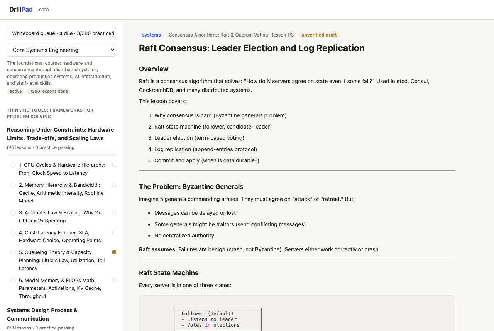
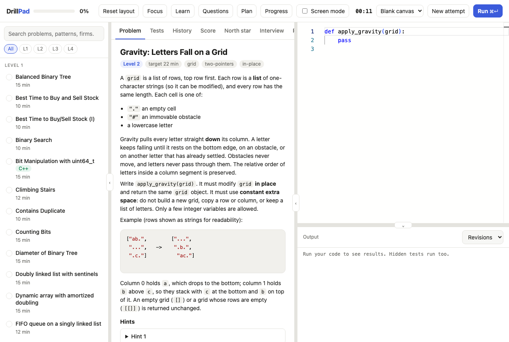
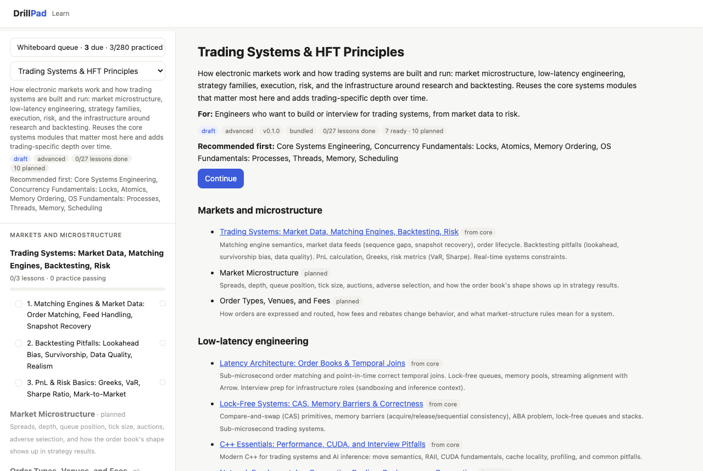

# DrillPad: learn systems engineering and practice the interview, locally

[](https://github.com/RyanJHamby/drillpad/actions/workflows/ci.yml)
[](LICENSE)
[](LICENSE-CONTENT.md)


**DrillPad is a free, local-first study environment** for engineers who want to go deep on systems, infrastructure, and
AI-infrastructure topics, and to practice interview-style problems under realistic conditions. It combines lessons, a code runner with
hidden tests, spaced repetition, and a whiteboard rep tracker. It runs on your machine, and your data stays there.



## What you get

- **Lessons on how systems work.** Hardware and concurrency, databases and distributed systems (consensus, consistency, transactions),
  operating production systems, system-design case studies, low-latency engineering, LLM inference and GPU fundamentals, and
  staff-level skills. Each lesson has diagrams, a worked failure scenario, interview questions with follow-ups, and a checklist.
- **Practice problems with real tests.** A local code editor and runner for Python, C++, and Rust, with hidden tests, hints, and
  follow-up stages that extend a problem. Some problems enforce *constant extra space* by measuring memory, not by trusting you.
- **Whiteboard reps that come back on a schedule.** After you redraw a lesson from memory, log a 1 to 5 self-score. Lessons return on a
  spaced-repetition schedule ([FSRS](https://github.com/open-spaced-repetition/free-spaced-repetition-scheduler)) and a queue shows what is due.
- **Learning tracks, not one long list.** The foundational course plus focused tracks (currently trading systems and power grids
  with compute) that reuse core lessons and add depth. You can add your own track as a folder or a separate git repository.
- **A planner and progress tracking.** Study queues with plain-language reasons, readiness by difficulty level, and weak-area tracking.
- **Optional AI mock interviewer.** Bring your own Anthropic API key; your session goes to the Anthropic API only if you configure one.

<table>
<tr>
<td></td>
<td></td>
</tr>
</table>

## Quick start

Requires Python 3.12+ and [uv](https://docs.astral.sh/uv/), on **macOS or Linux** (the runner uses POSIX resource limits; on Windows use WSL).
C++ and Rust problems also need `clang++` and `rustc` on your PATH; without them those problems are skipped and everything else works.

Install as a tool (nothing to clone):

```bash
uv tool install git+https://github.com/RyanJHamby/drillpad
drillpad serve                  # http://127.0.0.1:8765/learn  (localhost only)
```

Or from a clone, which is also how you contribute:

```bash
git clone https://github.com/RyanJHamby/drillpad && cd drillpad
uv sync
uv run drillpad serve
```

On macOS you can run it as a login item so a bookmark always works, with no terminal:

```bash
drillpad service install        # starts at login, restarts if it crashes
drillpad service status
drillpad service uninstall
```

## Your data stays local

`drillpad paths` shows where things live (macOS: `~/Library/Application Support/drillpad/`): the database, rotating consistent
backups, and an optional private overlay for modules or profiles you do not want anywhere else. Set `DRILLPAD_BACKUP_DIR` for an extra
copy of each backup (for example a cloud-synced folder). The server binds to `127.0.0.1` only and runs the code you type, so do not expose
it to a network. There is no telemetry. Your lessons, code, and progress never leave your machine; the one network dependency is that your browser
loads UI libraries (code editor, markdown, diagrams) from public CDNs (`cdnjs.cloudflare.com`, `cdn.jsdelivr.net`), so the pages need
an internet connection the first time they load. Bundling those libraries for offline use is on the roadmap.

## Learning tracks

| Track | What it is |
|---|---|
| `core` | The foundational course, in stages from hardware to staff-level skills |
| `trading-hft` | Market microstructure, low-latency engineering, strategy families, risk and operations (roadmap, reuses core modules) |
| `power-grid-compute` | How grids work and how datacenter and AI compute interact with them (roadmap, reuses core modules) |

Add your own: `python scripts/course.py new-curriculum my-track "My Track"`, or point `DRILLPAD_CURRICULA_PATH` at a folder or git
checkout. See [`docs/CURRICULA.md`](docs/CURRICULA.md).

## Status and honesty

DrillPad is **alpha**. Most lessons were drafted by AI models from the author's outlines and have **not yet had a systematic accuracy
review**; the app marks each lesson `unverified draft` until it carries a `Last verified` date. Treat lessons as study notes, not
sources, and open a "Content correction" issue when you find a mistake. Some planned modules are placeholders, shown greyed in the
Learn page.

## Scope and sources

This is an independent study project. It is not affiliated with, sponsored by, or endorsed by any company it mentions;
names appear only to identify what an example or term refers to. It is meant to contain no confidential or non-public
interview material, and contributions must not include any (see [`CONTRIBUTING.md`](CONTRIBUTING.md)). Practice problems
are reworded and reference public problem lists by title; scoring weights and point values are the author's own design
choices, not any firm's published rubric.

## Contributing

Corrections, new problems, new lessons, and whole new tracks are welcome. Read [`CONTRIBUTING.md`](CONTRIBUTING.md) first: content
needs sources for factual claims, runnable examples, and no confidential material. Maintenance workflow:
[`docs/MAINTAINING_THE_COURSE.md`](docs/MAINTAINING_THE_COURSE.md). Release history: [`CHANGELOG.md`](CHANGELOG.md).

## How this was built

Design, experiments, and analysis are mine. I used AI coding assistants for parts of the implementation, tests, and
documentation, and reviewed every change, with one exception described next.

The course content under `src/drillpad/content/modules/` was not reviewed that way: most of those lessons were drafted
by AI models from my prompts and outlines, and have not yet had a systematic accuracy review. Treat them as study notes,
not sources. A lesson carries a `Last verified: YYYY-MM-DD` line only after it has been checked against primary sources,
and unverified claims are tagged `[VERIFY]`.

## History

This repository starts at its first public snapshot. Earlier development happened in a private working repository,
which also holds material that is deliberately not published (personal practice data and notes). Releases are copied here from
that repository after an automated scan.

## License

Code: MIT (`LICENSE`). Course content and documentation: CC BY 4.0 (`LICENSE-CONTENT.md`).
