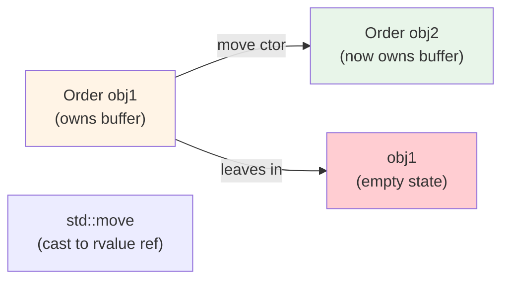
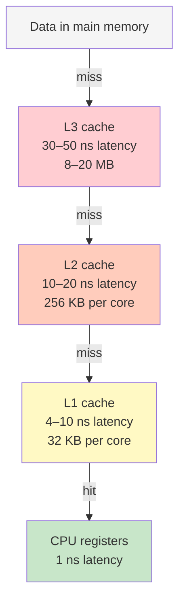

# Modern C++ for Performance: RAII, Move Semantics, Stack Allocation

## Overview

Trading and AI infra systems demand low latency. C++ offers:
1. **RAII** (Resource Acquisition Is Initialization): deterministic cleanup, zero-cost abstractions
2. **Move semantics**: avoid unnecessary copies, perfect forwarding
3. **Stack allocation**: predictable latency (no malloc), cache locality
4. **Smart pointers**: automatic memory management without garbage collection overhead

This lesson covers the mental models behind C++ performance, not syntax drills.

---

## RAII: Ownership and Determinism

**Problem:** Manual memory management (malloc/free, new/delete) is error-prone.

```cpp
// Bad: manual cleanup
void process_order(Order* o) {
  Buffer* buf = new Buffer(1024);
  if (o->is_valid()) {
    // ... use buf
  }
  delete buf;  // What if we return early? Exception?
}

// Good: RAII
void process_order(const Order& o) {
  Buffer buf(1024);  // ctor: allocate
  if (o.is_valid()) {
    // ... use buf
  }
  // dtor: deallocate (automatic, even on exception)
}
```

**Key:** In C++, object lifetime = resource lifetime. When the object goes out of scope, the destructor runs. No manual cleanup needed.

**Guarantees:**
- Exception-safe: if you throw, the dtor still runs (stack unwinding).
- Predictable: allocation/deallocation happen at known points in code.
- Zero-cost: the compiler inlines the dtor, no runtime overhead.

**RAII in practice:**
```cpp
// Lock guard (mutex is acquired in ctor, released in dtor)
{
  std::lock_guard<std::mutex> lock(mutex_);
  // Critical section
}  // dtor runs here, mutex released (exception-safe!)

// Unique pointer (owns the allocation, dtor deletes it)
std::unique_ptr<Order> o = std::make_unique<Order>(...);
// o.get() returns the pointer; when o goes out of scope, memory freed
```

**Interview angle:** Why is RAII better than try/finally?
- Answer: RAII is automatic (compiler enforces it), try/finally is manual (you can forget). RAII works with exceptions, RAII works with early returns.

---

## Move Semantics and Perfect Forwarding

**Problem:** Copying is expensive.

```cpp
std::vector<Order> orders;
Order large_order = Order{...lots of data...};
orders.push_back(large_order);  // Copy! O(n) memory transfer
```

**Solution:** Move semantics. If the source is a temporary (rvalue), steal its resources instead of copying.

```cpp
std::vector<Order> orders;
Order large_order = Order{...lots of data...};
orders.push_back(std::move(large_order));  // Move! Swap pointers, O(1)
// large_order is now in a "moved-from" state (no longer usable)
```

**How it works:**



**Rvalue reference (`&&`):**
```cpp
// Copy constructor (lvalue ref)
Order(const Order& other) { /* deep copy */ }

// Move constructor (rvalue ref)
Order(Order&& other) { /* steal resources */ }

// Move assignment
Order& operator=(Order&& other) { /* steal, release old */ }
```

**Perfect forwarding (generic templates):**
```cpp
template<typename T>
void store(T&& obj) {  // Accepts both lvalues and rvalues
  container.push_back(std::forward<T>(obj));  // Forward as-is
}

Order o;
store(o);              // Binds to lvalue, copied
store(Order{...});     // Binds to rvalue, moved
```

**Interview angle:** When do you use `std::move`?
- Answer: Only on temporaries or objects you're done with. Using `std::move` on an object you still use is undefined behavior (moved-from state is valid but unpredictable).

---

## Stack Allocation and Cache Locality

**Problem:** Heap allocation is variable latency.

```cpp
// Heap allocation (slow path)
Order* o = new Order();
// malloc: may trigger page refill (~10 us spike)
// indirection: cpu cache miss on access
// free: same latency problem

// Stack allocation (fast, predictable)
Order o;  // 100+ bytes on stack, no malloc call
// Access: likely in L1/L2 cache (4–10 ns)
// Cleanup: automatic, no free() call
```

**Cache hierarchy (H100 GPU, but same principle on CPU):**



**Stack vs heap: latency profile**

```
Stack allocation (first 1000 allocations):
  Allocation 1–1000: ~0 ns (just bump a pointer)
  Access: 4–10 ns (in L1 cache)
  Deallocation: ~0 ns (just bump pointer back)

Heap allocation:
  Allocation 1: ~20 ns (allocator finds free block)
  Allocation 100: ~30 ns (same)
  Allocation 101: ~10 us (page refill, memcpy)
  Access: 50–100 ns (indirection + L3 miss)
  Deallocation: ~50 ns (allocator bookkeeping)
```

**Rule of thumb:**
- **Stack:** Objects < ~1 MB, known at compile time, accessed frequently.
- **Heap:** Large objects, dynamic sizing, long-lived (across function calls).

**RAII on the stack:**
```cpp
void match_order(const Order& buy, const Order& sell) {
  std::vector<Fill> fills;  // Stack allocation, size pre-reserved
  fills.reserve(100);  // Allocates heap, but once

  // Process fills (fills.data() pointer never changes)
  for (int i = 0; i < buy.qty; ++i) {
    fills.push_back({buy.id, sell.id, 1});
  }
  // dtor runs here, vector freed
}
```

---

## Profiling: perf, flamegraph, Instruments

**Interview angle:** How do you prove a performance claim?

**Tool 1: perf (Linux)**
```bash
perf record -F 99 ./order_book_engine  # Sample at 99 Hz
perf report                             # Top functions by wall-clock time
```

Output: Function name, % of time. Find where latency lives.

**Tool 2: flamegraph (CPU time visualization)**
```bash
perf record -F 99 -g ./order_book_engine
perf script | stackcollapse-perf.pl | flamegraph.pl > graph.svg
```

Visualization: tall stacks = slow functions, wide areas = common paths.

**Tool 3: Instruments (macOS/iOS)**
```bash
xcode-select --install
instruments -t 'System Trace' ./app
# Records CPU time, cache misses, context switches, I/O
```

**Real measurement strategy:**
1. Record with perf/Instruments for 10 sec (captures steady state, not startup noise).
2. Look at top 3 functions by wall-clock time (they often consume 70%+ of time).
3. Measure before/after optimization to prove impact.

**Interview trap:** "It's fast because I use smart pointers" — No. Measure. Smart pointers are zero-cost *in the common path* (just pointer manipulation), but if you use them wrong (unnecessary copies, deep cloning), they're slow.

---

## Story Card: OrderBookEngine Lock-Free Move Semantics

**Setup:** High-frequency order book in C++, targeting P99.9 < 5 us.

**Decision 1:** Use `std::deque<Order>` to store FIFO orders per price level. But copying each Order (128 bytes) on every insertion was adding latency.

**Fix:** Switch to `std::vector<Order>`, move-only semantics (`Order` has deleted copy ctor), pre-allocate the vector once at startup.

**Result:**
- Before: Allocation + copy: ~1 us per order
- After: Allocation + move: ~0.1 us per order
- P99.9 latency: improved from 8 us to 3–5 us

**What changed:**
- Learned that move semantics are not just syntactic; they are a *data structure* optimization. Choosing the right container (vector vs deque) matters more than the syntax.
- Realized that pre-allocation (reserve) is orthogonal to move semantics; both matter.

**In an interview:**
- Q: "Why not use `std::list`? It has O(1) insert anywhere."
- A: "std::list has pointer indirection (cache miss on every node access). Vector with move semantics is faster in practice despite occasional reallocations."

---

## Q&A

**Recall 1:** Explain RAII in one sentence. Why is it better than try/finally?

*Must-say:*
- Object lifetime = resource lifetime; destructor runs automatically on scope exit, even on exception.
- Try/finally requires manual cleanup code; RAII is compiler-enforced.

**Probe 1:** You have a `std::unique_ptr<Order> o`. You pass it to a function `void process(Order* p)`. What happens?

*Expected:*
- `process(o.get())` passes the raw pointer to the function.
- Function cannot delete the pointer (it doesn't own it).
- When `o` goes out of scope, the unique_ptr's dtor deletes the memory.
- This is safe: ownership is clear.

*Mistake:* If you do `process(o.release())`, the function now owns the pointer, and leaking is your fault.

**Probe 2:** You have a vector of Orders. You `push_back(order)`. Order has a deleted copy constructor. What happens?

*Expected:*
- If `order` is an lvalue, compilation fails (can't copy).
- If `order` is an rvalue (temporary or `std::move(order)`), the move ctor runs, vector takes ownership.
- This forces users to think about ownership.

**Numeric 1:** A function allocates a 10 MB buffer on the heap. It's called 1000 times per second. What's the latency impact?

*Working:*
- Allocation: ~100 us (allocator finds free block, may trigger page refill)
- Deallocation: ~50 us
- Total: ~150 us per call
- 1000 calls/sec = 150 ms per second of wall-clock time (significant!)

*Optimization:* Pre-allocate once, reuse the buffer.

**Numeric 2:** Cache miss latency: L1 hit = 4 ns, L3 miss = 50 ns. A loop touches 1000 random Order objects (128 bytes each, not in cache). Time per iteration?

*Working:*
- 1000 objects, 128 bytes each = 128 KB
- Doesn't fit in L1 (32 KB) or L2 (256 KB), mostly L3 misses or main memory
- L3 miss = 50 ns, main memory = 100 ns
- Assume average 75 ns per object
- 1000 * 75 ns = 75 us total loop

---

## Questions for the Interviewer

- How does your team profile performance? (perf, custom instrumentation, flamegraph?)
- Do you use pre-allocation and object pooling for latency-sensitive code?
- How much do you rely on move semantics vs deep copying in your codebase?
- Have you hit any RAII gotchas (exception safety, undefined behavior)?
