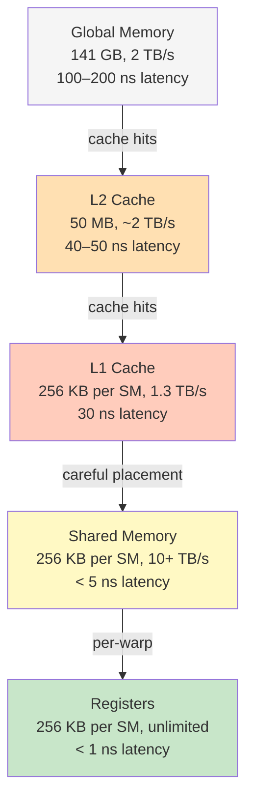
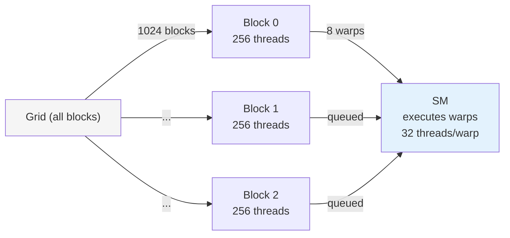

# CUDA Fundamentals: GPU Memory, Kernels, Occupancy, and Profiling

## Overview

CUDA is the dominant platform for GPU-accelerated inference and training. Key concepts:
1. **GPU memory hierarchy**: registers, shared memory, global memory (massive bandwidth tradeoff)
2. **Kernel launch**: threads, blocks, grids (how parallelism maps to hardware)
3. **Occupancy**: SM utilization, latency hiding, memory bandwidth
4. **Profiling**: nsys, ncu (NVIDIA Nsight Compute) to identify bottlenecks

Target: vLLM-adjacent inference work.

---

## GPU Memory Hierarchy (H100 Example)

An H100 GPU has **different memory types** at different speeds and sizes:



**Typical kernel bottleneck:** Global memory bandwidth.

```
H100 specs:
  Peak compute: 312 TFLOPS (FP32)
  Memory bandwidth: 2 TB/s
  Arithmetic intensity: 312 TFLOPS / 2 TB/s = 156 FLOPS per byte
  
Typical matmul (BF16):
  Arithmetic intensity: ~256 FLOPS per byte (high compute density)
  → Compute-bound, not memory-bound
  
Typical attention kernel (KV-cache):
  Arithmetic intensity: ~2 FLOPS per byte (low density)
  → Memory-bound, limited by 2 TB/s
```

**Key optimization lever:** Use shared memory as a cache to avoid global memory reads.

```cpp
// Without shared memory (bad):
__global__ void matmul_naive(float* A, float* B, float* C, int n) {
  int row = blockIdx.y * blockDim.y + threadIdx.y;
  int col = blockIdx.x * blockDim.x + threadIdx.x;
  float sum = 0;
  for (int k = 0; k < n; ++k) {
    sum += A[row * n + k] * B[k * n + col];  // n reads from global A, n reads from global B
  }
  C[row * n + col] = sum;
}
// Each thread reads n values from global memory (very inefficient)

// With shared memory (good):
__global__ void matmul_shared(float* A, float* B, float* C, int n) {
  __shared__ float sA[BLOCK_SIZE][BLOCK_SIZE];
  __shared__ float sB[BLOCK_SIZE][BLOCK_SIZE];
  
  // Load tile into shared memory (coalesced reads)
  sA[threadIdx.y][threadIdx.x] = A[...];
  sB[threadIdx.y][threadIdx.x] = B[...];
  __syncthreads();  // All threads wait for shared memory to load
  
  // Compute using shared memory (fast!)
  float sum = 0;
  for (int k = 0; k < BLOCK_SIZE; ++k) {
    sum += sA[threadIdx.y][k] * sB[k][threadIdx.x];
  }
  C[...] = sum;
}
// Threads reuse data loaded to shared memory (1 global load, ~BLOCK_SIZE uses)
```

---

## Kernel Launch, Blocks, and Occupancy

**Kernel execution model:**

A kernel is a function that runs in parallel on the GPU.

```cpp
__global__ void kernel(float* data) {
  int idx = blockIdx.x * blockDim.x + threadIdx.x;
  data[idx] = data[idx] * 2;
}

// Launch from CPU
kernel<<<gridDim, blockDim>>>(data);
// gridDim: (1024, 1, 1)   // 1024 blocks
// blockDim: (256, 1, 1)   // 256 threads per block
// Total threads: 1024 * 256 = 262K threads launched in parallel
```

**How it works:**



**Occupancy:** The ratio of active warps to maximum warps per SM.

```
H100 SM specs:
  Max threads per SM: 2048
  Max warps per SM: 128 (each warp = 32 threads)
  
If you launch blocks of 256 threads:
  256 / 32 = 8 warps per block
  2048 / 256 = 8 blocks per SM
  Occupancy: 8 blocks * 8 warps/block = 64 warps / 128 max = 50%
  
If you launch blocks of 1024 threads:
  1024 / 32 = 32 warps per block
  2048 / 1024 = 2 blocks per SM
  Occupancy: 2 * 32 = 64 warps / 128 max = 50%
  
Occupancy matters: low occupancy → GPU stalls waiting for memory,
can't hide latency with other warps.
```

**Interview angle:** Why do we care about occupancy?

**Answer:** GPUs hide latency by context-switching between warps. If 1 warp stalls on memory (100 ns), the SM can execute another warp (32 threads on a different part of the problem). If occupancy is low (few warps), memory stalls aren't hidden → throughput drops.

---

## Profiling: nsys and ncu

**Tool 1: nsys (system-level profiling)**

```bash
nsys profile --trace=cuda,osrt -o trace ./inference_app
nsys-ui trace.nsys-rep
```

Output: Timeline of kernel launches, memory transfers, context switches.

**What to look for:**
- **Kernel launch overhead:** Time between H2D and kernel execution.
- **Memory transfer time:** H2D (host→device), D2H (device→host).
- **Idle time:** GPU waiting for CPU (bad).
- **Kernel duration:** Is it the expected time?

**Real example (vLLM KV-cache prefill):**
```
Timeline:
  t=0ms:    H2D transfer (prompt tokens, 4 MB)
  t=0.5ms:  Kernel launch (prefill kernel)
  t=30ms:   Prefill kernel running
  t=30.5ms: D2H transfer (logits, 2 MB)
  t=31ms:   Idle (CPU processing)
  
P50 latency: 31 ms (bottleneck: H2D at start)
```

**Tool 2: ncu (kernel-level profiling)**

```bash
ncu --set full ./inference_app
# Collects: memory bandwidth, instruction throughput, occupancy, warp stalls
```

Output: Detailed counters per kernel.

**Key metrics:**
- **Achieved Memory Bandwidth:** How much of the 2 TB/s are you using?
  - If < 50% and no compute stalls: you're underutilizing memory (use wider memory access patterns).
  - If > 90%: you're memory-bound, optimize compute density or use shared memory.
  
- **Warp Stall Reason:** Why are warps stalling?
  - `STALL_MEMORY_DEPENDENCY`: Waiting for loads from global memory. Fix: use shared memory or pre-fetch.
  - `STALL_EXEC_DEPENDENCY`: Data dependencies between instructions. Fix: increase instruction-level parallelism.
  - `STALL_SYNC`: Waiting for `__syncthreads()`. Normal, but too many syncs = bad.
  
- **SM Occupancy:** Actual warps running / max warps.
  - Goal: 70%+ occupancy (hides memory latency).

---

## Real CUDA Kernel: Attention Softmax (Simplified)

Interview-style problem: Implement a softmax kernel for attention (takes KV-cache scores, outputs normalized weights).

```cpp
// Inputs:
//   scores: (batch, seq_len, seq_len) BF16
// Output:
//   attn_weights: (batch, seq_len, seq_len) BF16

__global__ void softmax_kernel(
    const half* scores,    // BF16 scores
    half* attn_weights,    // BF16 output
    int seq_len) {
  
  int batch = blockIdx.x;
  int q_pos = blockIdx.y;
  int tid = threadIdx.x;  // One row per block, threads cooperate
  
  // Step 1: Find max (for numerical stability)
  __shared__ float smax;
  float local_max = -INFINITY;
  for (int k = tid; k < seq_len; k += blockDim.x) {
    local_max = max(local_max, __half2float(scores[batch * seq_len * seq_len + q_pos * seq_len + k]));
  }
  local_max = block_reduce_max(local_max);  // Reduction across threads
  if (tid == 0) smax = local_max;
  __syncthreads();
  
  // Step 2: Compute exp(score - max) and sum
  float sum_exp = 0;
  for (int k = tid; k < seq_len; k += blockDim.x) {
    float score = __half2float(scores[batch * seq_len * seq_len + q_pos * seq_len + k]);
    sum_exp += expf(score - smax);
  }
  sum_exp = block_reduce_sum(sum_exp);  // Reduction
  if (tid == 0) smax = sum_exp;  // Reuse smax for sum
  __syncthreads();
  
  // Step 3: Compute softmax and store
  for (int k = tid; k < seq_len; k += blockDim.x) {
    float score = __half2float(scores[batch * seq_len * seq_len + q_pos * seq_len + k]);
    float attn = expf(score - smax) / smax;  // smax now holds sum_exp
    attn_weights[batch * seq_len * seq_len + q_pos * seq_len + k] = __float2half(attn);
  }
}
```

**Interview questions:**
- Q: "Why do you use shared memory for `smax`?"
  - A: To avoid redundant max() calls. All threads in a block read the same value, so we compute once and share.
  
- Q: "What's the occupancy here?"
  - A: If blockDim.x = 256, and we have ~2048 threads/SM, we can fit ~8 blocks concurrently. Occupancy ~50%.
  - Improvement: Increase blockDim.x to 512 (more threads per block, fewer blocks per SM, but more warps per block). Diminishing returns.

---

## Story Card: vLLM KV-Cache Quantization CUDA Kernel

**Setup:** vLLM inference, KV-cache is 8 GB (float32), taking up 40% of GPU memory. Goal: Quantize to int8 per-token (1/4 memory).

**Decision:** Write a custom CUDA kernel for per-token KV quantization (compute scale factor per token, clamp to int8, store scales separately).

**Implementation:**
- **Kernel 1:** Reduction kernel (find max value per token, compute scale).
- **Kernel 2:** Quantize kernel (clamp to int8, store in-place).

**Result:**
- Kernel time: ~2 ms for 4K context, batch 128 (much faster than memcpy alone at 8 ms).
- Memory saved: 6 GB (huge for batch size increase).
- Latency impact: Negligible (2 ms quantization vs 30 ms prefill).

**What changed:**
- Realized that custom kernels are only worth it if they beat the memcpy baseline or unlock new parallelism.
- Simple quantization (clamp + reduce) can be fused into a single kernel (no intermediate I/O).

**In an interview:**
- Q: "Why write a custom kernel instead of using a library (like CUTLASS)?"
- A: "Libraries are general-purpose; custom kernels can exploit domain-specific structure. Per-token quantization has a specific pattern (independent tokens, independent reductions per token), and we can fuse the max-finding and quantization into one kernel to reduce memory I/O."

---

## Q&A

**Recall 1:** What's the difference between global memory, shared memory, and registers?

*Must-say:*
- **Global:** Large (GB), slow (100+ ns), visible across all threads and blocks.
- **Shared:** Small (KB), fast (~5 ns), per-block, threads synchronize.
- **Registers:** Tiny (per-thread), fastest (< 1 ns), no synchronization needed.

**Recall 2:** Explain kernel occupancy. Why does it matter?

*Must-say:*
- Occupancy = active warps / max warps per SM. High occupancy (70%+) lets GPU hide memory latency by switching between warps.
- Low occupancy → memory stalls aren't masked → throughput suffers.

**Probe 1:** You have a kernel that reads 10 GB/s from global memory. H100 bandwidth is 2 TB/s. What's the bottleneck?

*Expected:*
- Compute: For every byte read, how many FLOPs? If < 156 FLOPs/byte (H100 peak), you're memory-bound.
- Example: Softmax (1 read per softmax op, ~10 FLOPs/op) → 10 FLOPs/byte → memory-bound.
- Fix: Use shared memory to reuse data, or increase compute per byte (e.g., fused kernels).

**Numeric 1:** A kernel launches 1024 blocks of 256 threads. H100 SM has max 2048 threads, max 8 blocks. How many blocks fit per SM? What's occupancy?

*Working:*
- 256 threads per block, max 2048 threads/SM → 2048 / 256 = 8 blocks per SM.
- Only 1 block can fit per SM (max 8 blocks). Wait, re-read: max 8 blocks per SM (hypothetical).
- Actually: H100 can hold more blocks (up to 16 blocks of 128 threads, or 8 blocks of 256 threads).
- Occupancy: 8 blocks * 256 threads = 2048 threads / 2048 max = 100%.

**Numeric 2:** A kernel runs in 5 ms. H2D transfer is 10 ms, D2H transfer is 5 ms. What's the total latency?

*Working:*
- If transfers are overlapped with kernel: max(H2D, D2H, kernel) = max(10, 5, 5) = 10 ms.
- If sequential: 10 + 5 + 5 = 20 ms.
- (Usually overlapped on modern GPUs.)

---

## Questions for the Interviewer

- How much of the inference pipeline is memory-bound vs compute-bound in your models?
- Do you use custom CUDA kernels or libraries (CUTLASS, cuDNN) for inference?
- How do you profile GPUs in production? (nsys, ncu, or custom instrumentation?)
- Have you hit any gotchas with mixed-precision inference (FP32 vs BF16 vs INT8)?
