# Ring AllReduce: Communication Pattern for Distributed Training

## Problem: AllGather Bandwidth

Standard AllGather on 8 GPUs:
```
GPU 0: has chunk A
GPU 1: has chunk B
GPU 2: has chunk C
...
GPU 7: has chunk H

AllGather: every GPU sends to every other GPU
  Total messages: 8 * 7 = 56 messages (each GPU sends to 7 others)
  Total bandwidth used: 56 messages on potentially oversubscribed network
  Network diameter: 3 hops (in some topologies)
  Latency: high due to congestion
```

---

## Ring AllReduce Algorithm

Arrange GPUs in a logical ring. Each GPU only communicates with neighbors.

```
Ring topology (logical, not physical):
  GPU 0 → GPU 1 → GPU 2 → ... → GPU 7 → GPU 0

AllReduce: sum all chunks, result on all GPUs
  (AllGather + Reduce combined)

Algorithm (2 phases):
  Phase 1: ReduceScatter (sum chunks, scatter results)
    GPU 0 sends A to GPU 1
    GPU 1 sends (B + A_recv) to GPU 2
    GPU 2 sends (C + B_recv) to GPU 3
    ...
    Total: N steps, each GPU sends 1 chunk

  Phase 2: AllGather (broadcast results back)
    GPU 0 sends (A + H_sum) to GPU 1
    GPU 1 sends (B + A_sum) to GPU 2
    ...
    Total: N steps

Total communication: 2N steps, each step = 1 chunk sent across 1 link
```

**Ring AllReduce sequence (8 GPUs, 2 phases):**

```mermaid
graph LR
  subgraph Phase1["Phase 1: ReduceScatter"]
    direction LR
    GPU0["GPU 0<br/>(A)"]
    GPU1["GPU 1<br/>(B)"]
    GPU2["GPU 2<br/>(C)"]
    GPU3["GPU 3<br/>(D)"]
    GPU4["GPU 4<br/>(E)"]
    GPU5["GPU 5<br/>(F)"]
    GPU6["GPU 6<br/>(G)"]
    GPU7["GPU 7<br/>(H)"]
    
    GPU0 -->|send A| GPU1
    GPU1 -->|send B+A| GPU2
    GPU2 -->|send C+B| GPU3
    GPU3 -->|send D+C| GPU4
    GPU4 -->|send E+D| GPU5
    GPU5 -->|send F+E| GPU6
    GPU6 -->|send G+F| GPU7
    GPU7 -->|send H+G| GPU0
  end
  
  subgraph Phase2["Phase 2: AllGather"]
    direction LR
    GPU0_2["GPU 0"]
    GPU1_2["GPU 1"]
    GPU2_2["GPU 2"]
    GPU3_2["GPU 3"]
    GPU4_2["GPU 4"]
    GPU5_2["GPU 5"]
    GPU6_2["GPU 6"]
    GPU7_2["GPU 7"]
    
    GPU0_2 -->|all_sum| GPU1_2
    GPU1_2 -->|all_sum| GPU2_2
    GPU2_2 -->|all_sum| GPU3_2
    GPU3_2 -->|all_sum| GPU4_2
    GPU4_2 -->|all_sum| GPU5_2
    GPU5_2 -->|all_sum| GPU6_2
    GPU6_2 -->|all_sum| GPU7_2
    GPU7_2 -->|all_sum| GPU0_2
  end
  
  Phase1 -->|every GPU has partial sum| Phase2
```



**vs. naive AllGather:**
- Naive: O(N^2) messages (congestion)
- Ring: O(N) steps, linear in number of GPUs (no congestion)

---

## Bandwidth Analysis

```
Ring AllReduce with N=8 GPUs:
  Phase 1: GPU 0→1→2→...→7 (8 steps, pipelined)
  Phase 2: GPU 0→1→2→...→7 (8 steps, pipelined)
  Total: 16 steps

Each step sends 1 chunk across 1 link (128 GB / 8 = 16 GB per chunk)

If NVLink 900 GB/s:
  Phase 1: 16 GB / 900 GB/s = 17.8 ms per step * 8 steps = 143 ms
  Phase 2: 143 ms
  Total: 286 ms

Naive AllGather (all-to-all):
  56 messages, congestion → likely 500+ ms (depends on switch capacity)

Ring is 50% of naive on ideal network, and much better on congested networks.
```

**Key:** Ring is bandwidth-optimal for AllReduce. Each network link carries exactly one chunk, no redundancy.

---

## Latency vs Bandwidth Trade-off

Ring AllReduce has high latency (sequential steps) but high bandwidth efficiency.

```
Latency: 2N network hops (serial dependencies)
Bandwidth: efficient, no congestion

vs. Tree AllReduce:
  Latency: O(log N) hops (much lower)
  Bandwidth: requires 2x bandwidth on top links (congestion)

Choice:
  Small N (< 16 GPUs): Tree AllReduce (latency-bound)
  Large N (32+ GPUs): Ring AllReduce (bandwidth-bound)
```

---

## Q&A

**Recall 1:** How does ring AllReduce reduce congestion vs naive AllGather?

*Answer:* Ring arranges GPUs in a logical ring and sends each chunk along the ring once per phase. Each network link carries exactly one chunk (no redundancy). Naive AllGather sends each chunk to every other GPU (O(N^2) messages), causing congestion on shared links.

**Numeric 1:** 16 GPUs, chunk size 64 GB, NVLink 900 GB/s. Ring AllReduce time?

*Working:* Phase 1: 16 steps * 64 GB / 900 GB/s ≈ 16 * 71 ms ≈ 1136 ms. Hmm, that's high. Actually, pipelining helps: first chunk is 71 ms, subsequent chunks overlap. So ~71 ms total for phase 1 if pipelined.

Actually, let me recalculate: in ring allreduce, each GPU sends one chunk per step. With pipelining, after the first chunk is sent by GPU 0, GPU 1 can send immediately (they send in parallel on different links). So phase 1 is 64 GB / 900 GB/s ≈ 71 ms (not 16x longer).

Total: 2 phases = 142 ms. Much better than 1136 ms.

**Probe 1:** You have 32 GPUs across 2 machines (16 per machine). Inter-machine link is 50 GB/s (slow), intra-machine NVLink is 900 GB/s. Ring AllReduce will be bottlenecked by inter-machine link. How do you optimize?

*Expected:* Use hierarchical AllReduce: Ring AllReduce within each machine (fast), then Tree AllReduce across machines (few hops). Or separate TP (intra-machine) from DP (inter-machine).

