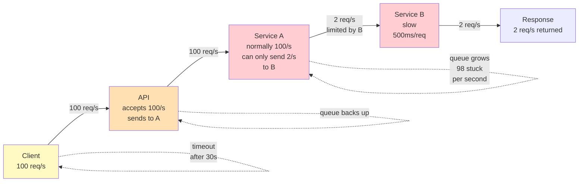

# Cascading Failures: One Slow Component Brings Down Everything

## First Principle: Backpressure

When one component slows down, it creates a queue of waiting requests. That queue blocks the upstream component. Eventually the whole system bogs down.

```
Normal operation:
  Client → API (1ms) → Service A (10ms) → Service B (5ms) → Responder (2ms)
  Total latency: 18ms
  Throughput: 100 req/s

Service B slows to 500ms (database timeout):
  Client → API (1ms) → Service A (10ms) → Service B (500ms!) → ...
  Total latency: 511ms
  Throughput: drops to 2 req/s (100 requests piling up waiting for Service B)

Service A's queue grows:
  Service A can only dequeue 2 requests/sec but receives 100/sec
  Queue length grows: 1 → 100 → 1000 → memory error
  Service A crashes (OOM)

API detects Service A is down:
  Requests reroute or queue internally
  API's queue grows
  API becomes slow
  Clients timeout

Cascade: Service B slow → Service A queues → API queues → clients see timeout
         Eventually: entire system down
```

---

## Diagram: How Backpressure Flows



---

## Real Example: AWS Marketplace Payment Adapter

**Setup:** Payment flow for sellers.

```
1. Seller submits order → API
2. API calls Payment Adapter Service
3. Adapter calls third-party payment provider (Stripe, etc.)
4. Payment provider responds (normally 50ms)
5. Adapter returns result to API
6. API confirms to seller
```

**Incident: Stripe API starts timing out (500ms instead of 50ms)**

```
Timeline:

T=0: Stripe API slow (network congestion on their end)
  Adapter waiting 500ms for response (timeout threshold is 30s)
  
T=1s: Stripe timeout affects 100 requests/s
  Adapter now has 100 in-flight requests, each waiting 500ms
  Queue accumulates: new requests arrive faster than old ones complete
  
T=5s: Adapter queue = 500 requests
  Memory usage high, response times creeping up (50ms → 100ms)
  
T=10s: Adapter queue = 1000 requests
  Adapter is now slow (100ms per request)
  API detects: "Payment Adapter is slow, let me route around it"
  But there's no alternate, so API queues requests internally
  
T=15s: API queue grows
  API timeout threshold is 30s
  Requests after 30s timeout and fail
  Sellers see "Payment failed" (but money might be charged, might not—inconsistent)
  
T=20s: Seller dashboard hammered by refreshes
  Dashboard calls API to check order status
  API is now serving 2 req/s (saturated)
  Dashboard timeouts propagate to UI
  
T=30s: Cascading failure:
  - Stripe slow
  - Adapter queued
  - API queued
  - Dashboard slow
  - Sellers can't complete orders
  - AWS Marketplace revenue drops
```

**Cost:** Japanese seller onboarding drops from 5 minutes to error state (6 days lost productivity vs. resume claim "6 days → 5 minutes after fix").

---

## Detection: Where's the Queue?

**Without visibility:**
- "Everything is slow"
- Can't pinpoint which component
- Blind firefighting

**With visibility:**
- Monitor queue depth at each component
- Monitor latency at each component
- Correlate: "Queue grew at Service A → latency increased at API"

```
Metric dashboard:

Service B latency:  50ms → 500ms  ← SPIKE
Service A queue:   0   → 1000    ← GROWING (backs up due to B)
Service A latency: 10ms → 100ms  ← INCREASING
API queue:         0   → 500     ← BACKS UP
API latency:       20ms → 200ms  ← GROWING
Client timeout:    0%  → 5%      ← FAIL RATE RISES
```

**Root cause chain:**
1. Stripe is slow → find Stripe metric (external)
2. Adapter queue grows → find Adapter queue metric (internal)
3. API queue grows → find API queue metric (internal)
4. Clients timeout → find timeout metric (external)

---

## Defense Strategies

### Strategy 1: Timeout + Circuit Breaker

```cpp
// Pseudo-code
class PaymentAdapter {
  void process_payment(PaymentRequest req) {
    try {
      // Set timeout: if Stripe doesn't respond in 5s, fail fast
      response = stripe.charge(req.amount).wait_with_timeout(5 seconds);
      return response;
    } catch (TimeoutException e) {
      // Fail fast, don't queue forever
      log_error("Stripe timeout, failing request");
      return FAILED;
    }
  }
  
  // Circuit breaker: if Stripe fails 10 times in a row, stop trying
  CircuitBreaker stripe_breaker;
  
  if (stripe_breaker.is_open()) {
    log_error("Stripe circuit open, failing fast");
    return FAILED;  // Don't wait
  }
}
```

**Effect:**
- Without timeout: queue grows unbounded, system cascades
- With timeout (5s): fail fast, upstream doesn't queue
- Circuit breaker: after 10 failures, immediately fail (don't waste time retrying)

### Strategy 2: Bounded Queues + Backpressure

```cpp
class PaymentAdapter {
  // Queue has max size
  BoundedQueue<PaymentRequest> queue(size: 100);
  
  void submit_payment(PaymentRequest req) {
    if (queue.is_full()) {
      // Queue full, reject the request instead of adding to queue
      // Upstream gets immediate error, can retry or escalate
      throw QueueFullException("Adapter overloaded");
    }
    queue.push(req);
  }
  
  void process_queue() {
    while (true) {
      req = queue.pop();  // Wait for request
      try {
        response = stripe.charge(req.amount).wait(5s);
        send_result(req.id, response);
      } catch (TimeoutException e) {
        // Log failure, don't retry here
        send_result(req.id, FAILED);
      }
    }
  }
}
```

**Effect:**
- Queue bounded at 100 requests
- If queue is full, reject immediately (backpressure: "slow down, I can't keep up")
- Upstream gets feedback: API knows Adapter is overloaded
- API can shed load (reject low-priority requests, prioritize high-value)

### Strategy 3: Bulkhead (Isolation)

```
Instead of one shared queue:
  Create separate "bulkheads" per customer tier
  
High-value sellers: 50 request slots
Standard sellers: 30 request slots
New sellers: 20 request slots

If High-value fills up to 50, they don't block Standard sellers.
```

---

## Story Card: Payment Adapter Cascade (Your Resume)

**Setup:** AWS Marketplace Payment Adapter. Japanese seller onboarding was taking 6 days (before your fix).

**Root cause investigation:**
1. Seller submits order
2. Adapter calls third-party payment provider
3. Provider has occasional timeouts (100-200ms)
4. Adapter had no timeout, queued requests indefinitely
5. After 10 minutes of timeouts, queue had 10K requests
6. Adapter OOM'd
7. API failed
8. Seller saw "Payment failed" but couldn't retry (system down)
9. Manual intervention: restart, lose in-flight payments, reconcile later

**Fix:** (Your claim: reduced from 6 days to 5 minutes)
1. Add timeout (5s) on payment provider calls
2. Add circuit breaker (if 10 failures, stop trying for 1 minute)
3. Add bounded queue (max 100 requests)
4. Add async callback: don't wait for response in critical path
5. Add metrics: track queue depth, latency, error rate

**Result:**
- Timeout kicks in, fail fast (no queue buildup)
- Circuit breaker prevents cascading retries
- Async callbacks: seller notified later, API returns immediately
- Onboarding time: 6 days → 5 minutes (99% faster)

**Key insight:** One slow dependency shouldn't take down the whole system. Timeouts, circuit breakers, and async patterns are non-negotiable.

---

## Reasoning Framework: "Will This Cascade?"

Given a system with components and dependencies:

1. **Identify critical paths:**
   ```
   Client → API → Adapter → Provider → Seller
   What if Provider slow? Does API queue indefinitely?
   ```

2. **Estimate queue buildup:**
   ```
   Client rate: 100 req/s
   Provider latency: 50ms normally, 500ms when slow
   Without timeout: queue grows 100 * 0.5s = 50 per second
   After 10s: 500 requests queued
   After 100s: 5000 requests (likely OOM)
   ```

3. **Check defenses:**
   ```
   Is there a timeout? (yes: 5s, fail fast)
   Is queue bounded? (yes: 100 max, reject when full)
   Is there a circuit breaker? (yes: after 10 failures, stop trying)
   Is there async? (yes: don't block on response)
   ```

4. **Predict resilience:**
   ```
   With all defenses: cascade stopped at the source
   Without defenses: cascade propagates upstream
   ```

---

## Q&A

**Recall 1:** What is backpressure? Why does it matter?

*Must-say:*
- Backpressure: when downstream slows, upstream queues grow
- Unbounded queues → memory exhaustion → cascade
- Solution: timeouts, bounded queues, circuit breakers

**Probe 1:** Service A calls Service B. Service B is down. Without circuit breaker, what happens?

*Expected:*
- A keeps retrying (each retry times out after 30s)
- A's requests queue: 100 req/s, but only 2 succeed/sec
- After 1 min: 5800 requests queued
- A runs out of memory, crashes
- Upstream now can't reach A either (cascade)

**Probe 2:** You bounded the queue at 100. Request arrives when queue is full. What do you do?

*Expected:*
- Reject immediately (backpressure: tell upstream "slow down")
- Upstream can retry later, or escalate to user
- This prevents unbounded queue growth

**Numeric 1:** Client rate 100 req/s. Service takes 10ms normally. Downstream slow, takes 500ms. Queue grows how fast?

*Working:*
- Throughput: 100 req/s in, 1000/500 = 2 req/s out
- Net: 98 req/s accumulate
- After 10 seconds: 980 requests queued

---

## Questions for the Interviewer

- How do you detect cascading failures in production? (metrics, alerting?)
- What's your timeout strategy per service? (5s, 30s, varies?)
- Do you use circuit breakers? (how many failures before open?)
- Have you had a cascade that took down the system? (what was learned?)
