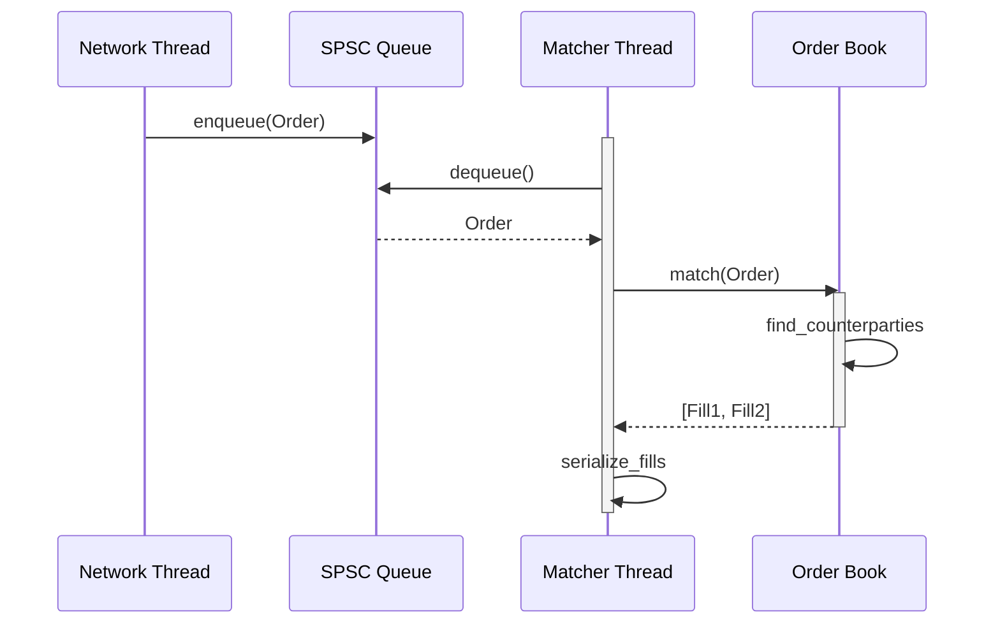

# Order Book Engine: Data Structures and Lock-Free Ingestion

## Overview

An order book is a matching engine: buy and sell orders arrive asynchronously, and the engine matches them to execute trades. This lesson covers:
1. Core data structures (two trees for buy/sell sides)
2. Lock-free producer/consumer pipeline
3. Memory allocation strategy to guarantee latency
4. Matching and fill semantics

---

## Data Structure: Two Priority Queues (Price-Time)

An order book maintains two sides:

```
Buy side (descending price priority):
  Price $101.50 │ Order 5 (qty 100) → Order 3 (qty 50)
  Price $101.00 │ Order 2 (qty 200)
  Price $100.50 │ Order 1 (qty 150)

Sell side (ascending price priority):
  Price $102.00 │ Order 7 (qty 75)
  Price $102.50 │ Order 6 (qty 100) → Order 4 (qty 50)
  Price $103.00 │ Order 8 (qty 200)
```

**Matching rule (price-time priority):**
- A buy order matches against the lowest sell price (if buyer's price >= seller's price).
- Within a price level, orders match in time order (FIFO).

**Interview probe:** Why do you need *two* trees, not one? Why not just keep all orders in insertion order and scan?

Implementation: Each side is a `std::map<Price, std::deque<Order>>` or similar.
- `std::map` gives you sorted by price (red-black tree, O(log n) insert/delete).
- `std::deque<Order>` per price level keeps FIFO order (O(1) pop from front).

---

## Matching Example (Continuous Trading)

```
State 1: Book is empty
  Buys:  (empty)
  Sells: (empty)

Action: Sell order arrives, qty=100 @ $101.00
  → No matching buy at $101+. Insert at $101.
  
State 2:
  Buys:  (empty)
  Sells: Price $101 │ SellOrder(qty=100)

Action: Buy order arrives, qty=50 @ $102.00
  → Best sell is $101, buyer offers $102 >= $101. MATCH.
  → Fill qty=50, sell order reduced to qty=50.
  
State 3:
  Buys:  (empty)
  Sells: Price $101 │ SellOrder(qty=50)

Action: Buy order arrives, qty=50 @ $100.50
  → Best sell is $101, buyer offers $100.50 < $101. NO MATCH.
  → Insert buy at $100.50.
  
State 4:
  Buys:  Price $100.50 │ BuyOrder(qty=50)
  Sells: Price $101 │ SellOrder(qty=50)
```

Each arrival can trigger 0, 1, or many fills (if buy qty > sell qty at best ask).

---

## Producer-Consumer Pipeline (Lock-Free Ingestion)

Orders arrive on a network thread (producer) but matching happens on a dedicated matcher thread (consumer). Use a lock-free SPSC (single-producer, single-consumer) queue to avoid blocking.

```
Producer (network):               Consumer (matcher):
  Order arrives                      Dequeue from queue
    ↓                                  ↓
  Validate format                    Match against book
    ↓                                  ↓
  Enqueue to SPSC                    Update best bid/ask
    ↓                                  ↓
  [yield/return]                     Serialize fill
                                       ↓
                                     Enqueue response
```

**Sequence diagram:**



**SPSC queue properties:**
- Lock-free: no mutexes, no context switches (in the hot path).
- Single producer, single consumer: prevents contention pathologies.
- Bounded: fixed ring buffer (256 slots, say) prevents unbounded memory growth.
- Linearizable: reads/writes are ordered like a queue.

**Implementation detail:** On a single shared core, spinning while waiting for space is harmful (see Lesson 1). Real implementations:
- Spin for a few iterations (10–100 cycles, ~30 ns).
- If still full, yield the CPU (let OS scheduler give time to consumer).

---

## Memory Pool Strategy (Predictable Allocation)

Without pre-allocated pools, `malloc` is variable latency: first allocation is fast (10s of ns), but after ~100 allocations, pages refill and the cost jumps to microseconds.

```
Latency without pool (real measurement):
  Allocations 1–100: ~20 ns (fast path, allocator has free blocks)
  Allocation 101:    ~10 us (page refill, malloc locks, OS calls)
  Allocation 102–200: ~20 ns (fast path again)
  
This 500x spike at allocation 101 is invisible to P50 (median), but dominates P99.9.
```

**Solution: Pre-allocate pools at startup.**

```
At server startup:
  1. Allocate a large chunk from the OS once (e.g., 10 MB for 100K orders).
  2. Carve it into fixed-size Order structs.
  3. Maintain a free-list (stack) of available slots.
  4. Allocation: pop from stack (O(1), ~10 ns).
  5. Deallocation: push back to stack (O(1), ~10 ns).

Result:
  Every allocation is ~10 ns (constant), no surprises.
```

**Data structure:**

```cpp
struct Order {
  uint64_t order_id;
  char side;  // 'B' or 'S'
  uint32_t qty;
  uint32_t price;
  uint64_t timestamp_ns;
};

class OrderPool {
  std::vector<Order> storage;  // pre-allocated at startup
  std::vector<Order*> free_list;
  
public:
  Order* allocate() {
    Order* o = free_list.back();
    free_list.pop_back();
    return o;  // O(1), ~10 ns
  }
  
  void deallocate(Order* o) {
    free_list.push_back(o);  // O(1), ~10 ns
  }
};
```

---

## Latency Profile (Real Measurement from OrderBookEngine)

From the OrderBookEngine benchmark (EC2 c6i.large, 1M orders, real matching):

```
Operation breakdown (measured):
  Format validation:     ~0.05 us
  Symbol table lookup:   ~0.1 us (if pool-allocated; ~5 us if malloc)
  Memory pool alloc:     ~0.01 us
  Tree insert (no fill): ~0.1 us
  Matching loop (fills): ~1–3 us (depends on fill count)
  Serialization:        ~0.05 us
  ──────────────
  P50 total (no fill):   ~0.2 us
  P99.9 (many fills):    ~3–5 us
```

**P99.9 spike drivers:**
1. Tree rebalancing (red-black tree can rebalance during insert, ~10–50 extra operations in the worst case).
2. Cache misses (order array not in L3, falls through to main memory).
3. Multiple fills (for each fill, you scan the matching queue, allocate a fill record, etc.).

---

## Story Card: OrderBookEngine Matching Implementation

**Setup:** Built order book in C++20 targeting sub-microsecond latency for the exchange. First attempt used `std::map` + `std::mutex`.

**Decision:** Switched to lock-free SPSC queue for producer/consumer, but *kept the mutex* protecting the order book trees (matching is single-threaded, so no contention on the book itself).

**Result:**
- Lock-free queue eliminates network thread blocking.
- Single-threaded matcher avoids synchronization overhead in the matching loop.
- Achieved P50 0.2 us, P99.9 3–5 us on EC2.

**What changed:**
- Realized lock-free doesn't mean "no locks anywhere"; it means "locks in the right places" (producer/consumer link, not the hot path).
- Learned that single-threaded matching can be faster than multi-threaded with fine-grained locking (no cache coherency overhead).

**In an interview:**
- Q: "Isn't single-threaded matching a bottleneck?"
- A: "Not if it's saturated. With 1M+ orders/sec on one core, the matcher *is* the bottleneck. Adding more matchers on other cores introduces synchronization overhead (updating the shared book) that's worse than just feeding one core as much as it can handle. If you need more throughput, you shard: run multiple books (e.g., by symbol), each with its own matcher thread."

---

## Q&A

**Recall 1:** Describe the data structure for a single price level in an order book. Why that structure?

*Must-say:*
- A queue (FIFO) of orders at that price level.
- FIFO respects price-time priority: best price first, then earliest arrival first.

*Model answer:*
- Use `std::deque<Order>` (or similar) because:
  - O(1) pop from front (best order is first), O(1) push to back (new orders enqueue at end).
  - Iterator stability for partial fills (fill from front, don't move middle orders).

**Probe 1:** Matching happens in a loop. A sell order arrives, and there are 5 buy orders at or above the sell price. Walk me through the matching loop.

*Expected:* 
- Scan buy orders from best price down until you hit a price below the sell price.
- For each buy, compute fill qty = min(remaining buy qty, remaining sell qty).
- Allocate a fill record, emit it.
- If sell qty exhausted, break. If buy order exhausted, move to next.

**Probe 2:** You benchmark your matcher and P99.9 jumps from 1 us to 10 us after 1M orders. What's your hypothesis?

*Expected:*
- Cache working set grew. Early orders fit in L3 cache; later orders miss L3 and hit main memory.
- Or: tree rebalance happened (only after enough inserts).
- Or: memory page refill (if you're not using a pre-allocated pool).

Test it: Add a `pow log` step to measure L3 misses or page faults.

**Numeric 1:** You have 10,000 pre-allocated Order structs at 128 bytes each. How much memory is that (in MB)?

*Working:* 10,000 * 128 bytes = 1,280,000 bytes ≈ 1.28 MB.

**Numeric 2:** A fill operation allocates an Order struct from the pool (O(1), 10 ns), matches it against the book (O(log n), 100 ns for n=10K), and serializes a response (50 ns). Assume fills happen at P99 (1 fill per 100 orders). What's the latency contribution of fills to P99.9 latency?

*Working:*
- Per-order: 10 ns (alloc) + 100 ns (match, amortized) + 50 ns (serialize) = 160 ns.
- P99.9 sees ~10 fills on average (rough; real distribution is complex).
- Total: 10 * 160 ns = 1600 ns = 1.6 us.

---

## Questions for the Interviewer

- How do you handle partial fills? Does your matching loop allocate per fill, or batch-allocate?
- Do you use thread-local memory pools, or a global pool with locks?
- How do you prevent tail latency from tree rebalancing? (Rebalancing happens rarely; O(log n) amortized.)
- What's your order book sharding strategy if you need to scale beyond one matcher thread?
