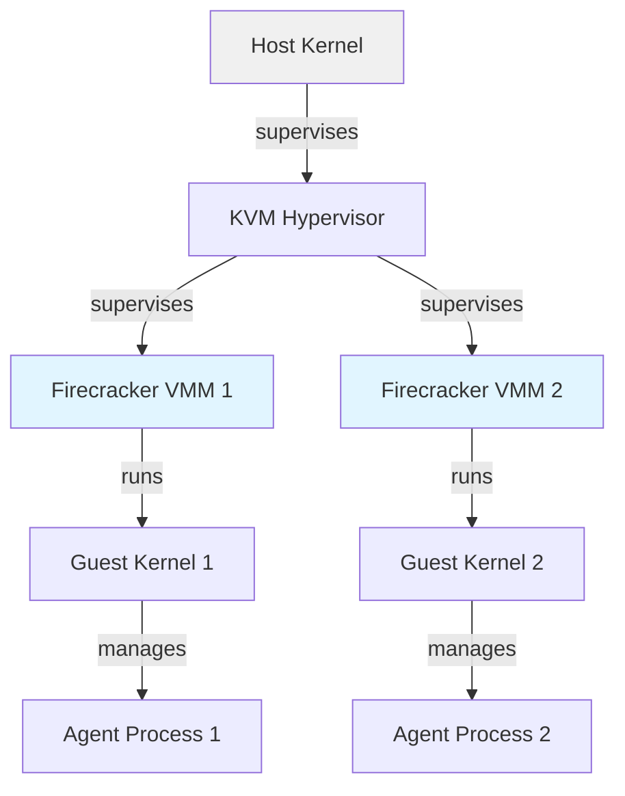

# Firecracker for Agent Isolation: Boot Time, Resource Limits, Networking


## Why Sandboxing for LLM Agents?

Platforms that run user code (LLM agents) isolate it in VMs. Threats:

```
Bad agent code:
  fork() bomb: create 10^6 processes, exhaust system resources
  Memory bomb: malloc 1 TB, OOM the entire server
  Network bomb: ddos an external service, external IP blacklisting hits all agents
  Infinite loop: while(1) compute, starve other agents
  
Naive solution: Unix process isolation (getrlimit, cgroups)
  Problem: Kernel is shared, can still DoS kernel itself (kmem exhaustion, syscall bomb)
  Agents can ptrace other processes, read /proc, escape sandboxes
  
Firecracker (lightweight VM):
  Separate Linux kernel per agent (not shared)
  Hardware-enforced isolation (EPT, IOMMU)
  Minimal attack surface (no PCI, no USB, no ACPI)
```

---

## Firecracker Architecture

```
Host kernel → hypervisor (KVM) → Firecracker (VMM) → guest kernel → agent process

Overhead per VM:
  Memory: 8–15 MB (vs 500 MB per process-based sandbox)
  CPU: ~1% overhead (vs negligible for process isolation)
  Boot time: 100–300 ms (vs ~instant for process spawn)

Host sees:
  Firecracker process (single host process, ~50 MB RSS at idle)
    └─ Guest kernel (minimal, ~5 MB)
    └─ Agent code (runs in guest user space)
```

**Architecture:**



---

## Boot Time and Startup Latency

Firecracker VMs boot in 100–300 ms on modern hardware (x86, arm64 with pKVM).

```
Boot sequence (illustrative agent-sandbox timeline):
  t=0:     User submits "search the web and summarize"
  t=5ms:   API creates new Firecracker VM (vmm process spawns)
  t=20ms:  Guest kernel boots (custom minimal kernel, no ACPI, no USB drivers)
  t=50ms:  Guest init runs, starts agent process
  t=100ms: Agent starts (landing in Python interpreter, loading model weights)
  t=200ms: Agent ready to process (model inference starts)

Total latency: 200 ms until agent processes first request
```

**Key optimization:** Pre-warm VMs (keep a pool of idle Firecracker VMs ready, not started per-request).

```
Pool pre-warming:
  Maintain 10 idle VMs (started but waiting for input)
  Agent inside each VM is blocked on stdin
  When request arrives: send code + context to VM via stdin
  VM executes immediately (no boot time)
  
Latency with pre-warming:
  t=0: Request arrives
  t=0: Pick idle VM from pool
  t=0ms: Send code to VM via gRPC/socket
  t=2ms: Code executes (already booted)
  
  Trade-off: 10 idle VMs * 50 MB = 500 MB memory overhead
  Benefit: 200 ms faster response time per request
```

---

## Resource Limits in Firecracker

Firecracker VMs have explicit resource quotas:

```
VM 1: agent A (user code)
  CPU: 1 vCPU (pinned to host core 2)
  Memory: 512 MB
  Network: 100 Mbps egress limit (token-bucket shaper)
  Disk: 2 GB tmpfs
  
If agent A tries:
  fork() bomb: creates 100 processes → inside-VM kernel OOMs or process limit hit
  Memory bomb: malloc 1 TB → inside-VM OOM killer kills agent
  Network bomb: send 1 Gbps → traffic shaper limits to 100 Mbps, packets dropped
  
Host is unaffected. Only VM 1 is impacted.
```

**Implementation:**
```
Firecracker config (JSON):
{
  "vcpu_count": 1,
  "mem_size_mib": 512,
  "network_interfaces": [
    {
      "iface_id": "eth0",
      "rx_rate_limiter": {
        "bandwidth": {"size": 100_000_000}  // 100 Mbps in bytes
      }
    }
  ],
  "block_devices": [
    {
      "drive_id": "rootfs",
      "path_on_host": "/tmp/vm_rootfs.img"
    }
  ]
}
```

---

## Networking: Isolation + Access

Agents need to make outbound requests (fetch web pages, call APIs) but shouldn't see each other or the host.

```
Network topology:

  Host (198.51.100.1)
    ├─ Bridge (br0, 10.0.0.0/24)
    ├─ Firecracker VM 1 (guest IP 10.0.0.2)
    ├─ Firecracker VM 2 (guest IP 10.0.0.3)
    └─ Firecracker VM 3 (guest IP 10.0.0.4)

Problems:
  1. Agents on same network (10.0.0.0/24) can ping each other, leak info
  2. Agents can reach host (10.0.0.1), potentially exploit services
  
Solutions:
  1. Network policies (iptables inside host namespace):
     iptables -A FORWARD -s 10.0.0.2 -d 10.0.0.3 -j DROP
     iptables -A FORWARD -s 10.0.0.2 -d 10.0.0.1 -j DROP
     Agents can only reach external internet, not each other
  
  2. Separate networks per VM (more secure, more complex):
     VM 1 has tap0 on 10.1.0.0/24
     VM 2 has tap1 on 10.2.0.0/24
     No cross-VM network paths at all
```

**Egress filtering (prevent botnet abuse):**
```
Agents can call external APIs, but rate-limit and block known malicious IPs.

Config:
  Max 100 concurrent outbound connections per VM
  Max 1 request per second to any single external IP (prevent scanning)
  Block list: [8.8.8.8, cloudflare, …] (don't allow recursive DNS amplification)
```

---

## Resource Contention and Performance Isolation

Even with separate VMs, they share the host CPU and memory bandwidth.

```
Host has 32 cores, 256 GB RAM
Deploy 64 Firecracker VMs (each 512 MB = 32 GB total, each 0.5 vCPU = 32 vCPU assigned)
Oversubscription: 32 vCPUs overcommitted to 32 physical cores (1:1 ratio)

If agent A runs a tight loop (CPU-bound):
  Uses its 1 vCPU fully
  KVM scheduler gives it 0.5 physical core time (overcommitted)
  Other agents see latency (context switching between VMs)
  Agent B's 10 ms decode step becomes 15 ms (waiting for host CPU)
```

**Mitigation:**
```
1. Under-provision VMs: deploy only 32 VMs on 32 cores (1 vCPU per VM)
2. CPU isolation: use cgroups (cpuset) to pin VMs to cores
3. Monitoring: measure VM-to-VM crosstalk latency, alert if > threshold
4. Throttling: if host CPU > 90%, queue new requests instead of spawning VMs
```

---

## Interview-Style: Firecracker + vLLM

**Q: You have 10 agents, each in a Firecracker VM, each running inference on a shared GPU. How do they coordinate?**

*Expected:*
- Central inference scheduler (outside VMs, in host namespace).
- Agent 1 (in VM 1) calls scheduler API: "inference.run(prompt, model_id)"
- Scheduler queues the request, batches it with other agents' requests.
- Scheduler runs prefill + decode on GPU, returns tokens to Agent 1.
- Agent 1's VM receives response via gRPC/socket.
- No GPU access inside VMs; GPU is host-only.

**Q: An agent's request takes 2 seconds. During that time, the agent's VM is blocked waiting for inference results. Is that a problem?**

*Expected:*
- Not a problem per se (agent is blocked anyway, can't do work).
- But it is wasteful: VM memory is still allocated (512 MB), and the 1 vCPU is held.
- Optimization: after scheduling inference, close the VM or move it to a "paused" state, free the vCPU back to the host pool.
- When inference finishes, wake the VM (or spawn a new one, cheaper on Firecracker).

**Q: How do you prevent one agent from stealing all the GPU?**

*Expected:*
- Fair queuing in the scheduler: round-robin or weighted fair queueing.
- Each agent gets a request token each iteration.
- If agent A submits 100 requests, only 1 is processed per round, others queue.
- Prevents starvation.

**Numeric 1:** You have 10 VMs, each 512 MB memory, booted and idle. How much memory is used (guest OS + hypervisor overhead)?

*Working:* 10 VMs * (8 MB guest kernel + 5 MB Firecracker + 512 MB guest memory) = 10 * 525 MB ≈ 5.25 GB. (Rough; actual is 5–6 GB depending on tuning.)

**Numeric 2:** Boot time is 150 ms. You spawn VMs on-demand (no pre-warming). Agent request arrives, you create VM, VM boots, agent runs inference (200 ms). Total latency?

*Working:* 150 ms (boot) + 200 ms (inference) = 350 ms. With pre-warming, you save the 150 ms boot time.

---

## Illustrative Story: Pre-Warmed VM Pools

Consider a hypothetical agent-sandbox platform that launched with Firecracker VMs for isolation (all numbers illustrative). Initial design used pre-warmed VM pools (10 idle VMs). When request volume spiked, they ran out of idle VMs, had to spawn on-demand, saw 200 ms boot latency added to p99. Fixed by: dynamic pool sizing (scale pool up when queue depth > threshold), plus allowing some VM spawn if queue is full.

