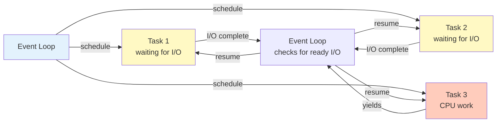

# Asyncio Concurrency: Event Loop, Coroutines, Producer-Consumer

## Overview

Modern inference servers (vLLM and similar serving stacks) use Python with asyncio for concurrency:
1. **Event loop**: Single-threaded, handles 1000s of concurrent requests.
2. **Coroutines**: Lightweight tasks (no OS threads, no GIL contention).
3. **Producer-consumer patterns**: Async queues for request batching.

Target: Interview questions on inference orchestration, request batching, backpressure.

---

## Event Loop and Coroutines

**Problem:** Synchronous I/O blocks the thread.

```python
# Synchronous (bad for servers)
def fetch_prompt(url):
    response = requests.get(url)  # BLOCKS for ~100 ms
    return response.text

# Serve 100 requests → 100 * 100 ms = 10 seconds (only 1 request at a time!)

# Asynchronous (good)
async def fetch_prompt(url):
    response = await aiohttp.ClientSession().get(url)  # Yields control while waiting
    return response.text

async def serve():
    # Run 100 requests concurrently
    tasks = [fetch_prompt(url) for url in urls]
    results = await asyncio.gather(*tasks)
    # Total time: ~100 ms (all concurrent, not sequential)
```

**How asyncio works:**



**Key concepts:**

```python
async def fetch_prompt(url):
    # Coroutine: a function that can pause/resume
    # 'await' is a pause point: yields control to event loop
    session = aiohttp.ClientSession()
    response = await session.get(url)  # Pause here, other tasks run
    await session.close()  # Pause again
    return response.text

# Create a task (schedules the coroutine on the event loop)
task = asyncio.create_task(fetch_prompt(url))

# Wait for result
result = await task

# Run multiple concurrently
async def main():
    # Method 1: gather (simple)
    results = await asyncio.gather(
        fetch_prompt(url1),
        fetch_prompt(url2),
        fetch_prompt(url3)
    )
    
    # Method 2: TaskGroup (modern, Python 3.11+)
    async with asyncio.TaskGroup() as tg:
        task1 = tg.create_task(fetch_prompt(url1))
        task2 = tg.create_task(fetch_prompt(url2))
    
    # Method 3: wait with timeout
    done, pending = await asyncio.wait(tasks, timeout=5)
    # done: completed tasks
    # pending: still running (will be cancelled if not awaited)

asyncio.run(main())
```

**Interview angle:** Why asyncio over threading?

**Answer:**
- **asyncio:** Single OS thread, 1000s of coroutines, lighter weight, no GIL (global interpreter lock) contention, easier to debug.
- **threading:** Multiple OS threads, heavy-weight (MB per thread), GIL prevents true parallelism in CPU-bound code, harder to sync.
- **For I/O-bound:** asyncio is superior (e.g., 1000 concurrent HTTP requests).
- **For CPU-bound:** Use multiprocessing or PyPy/Cython to bypass GIL.

---

## Producer-Consumer with Async Queues

**Pattern:** One producer (request handler) enqueues requests, consumer (inference worker) dequeues and processes.

```python
import asyncio

# Shared queue between producer and consumer
request_queue = asyncio.Queue(maxsize=100)

async def producer():
    """Enqueue incoming requests."""
    for i in range(100):
        request = f"prompt_{i}"
        await request_queue.put(request)  # Pause if queue is full
        print(f"Produced: {request}")
        await asyncio.sleep(0.01)  # Simulate request arrival rate

async def consumer():
    """Dequeue and process requests."""
    while True:
        try:
            request = await asyncio.wait_for(
                request_queue.get(),
                timeout=5
            )
        except asyncio.TimeoutError:
            print("No requests for 5 seconds, exiting")
            break
        
        print(f"Processing: {request}")
        await asyncio.sleep(0.05)  # Simulate inference latency
        print(f"Done: {request}")

async def main():
    # Run producer and consumer concurrently
    await asyncio.gather(
        producer(),
        consumer()
    )

asyncio.run(main())
```

**Output:**
```
Produced: prompt_0
Processing: prompt_0
Produced: prompt_1
Done: prompt_0
Processing: prompt_1
...
```

**Backpressure (producer slows down if queue is full):**

```python
async def producer():
    for i in range(1000):
        await request_queue.put(f"prompt_{i}")
        # If queue is full (maxsize=100), put() pauses
        # Producer waits until consumer drains the queue
        
# Result: memory-bounded, no unbounded queue growth
```

**Interview angle:** What happens if the producer is faster than the consumer?

**Answer:** Queue fills up to maxsize, producer pauses (await put() blocks). Consumer catches up, queue drains, producer resumes. This is backpressure: a flow-control mechanism that prevents memory bloat.

---

## Async Context Managers and Resource Management

**Problem:** Resources (connections, sessions, files) need cleanup.

```python
# Bad: manual cleanup
session = aiohttp.ClientSession()
try:
    response = await session.get(url)
finally:
    await session.close()  # Easy to forget

# Good: async context manager
async with aiohttp.ClientSession() as session:
    response = await session.get(url)
# session.close() runs automatically

# Multiple resources
async with asyncio.TaskGroup() as tg:  # Auto-cancel all tasks on exception
    async with aiohttp.ClientSession() as session:
        task = tg.create_task(fetch_prompt(url, session))
```

**Implementing custom context managers:**

```python
class InferenceServer:
    async def __aenter__(self):
        self.model = await load_model_async()  # Async init
        return self
    
    async def __aexit__(self, exc_type, exc_val, exc_tb):
        await self.model.cleanup()  # Async cleanup

async def main():
    async with InferenceServer() as server:
        result = await server.infer("prompt")
    # cleanup() runs here, even on exception
```

---

## Common Asyncio Pitfalls

### Pitfall 1: Forgetting `await`

```python
async def infer(prompt):
    return await model.generate(prompt)

# Wrong: missing await
result = infer("hello")  # Returns a coroutine object, doesn't run it
print(result)  # <coroutine object at 0x...>

# Right: await the coroutine
result = await infer("hello")  # Actually runs the coroutine
```

### Pitfall 2: Blocking the Event Loop

```python
async def infer(prompt):
    # BAD: time.sleep() blocks the entire event loop
    time.sleep(1)  # No other tasks run for 1 second
    return await model.generate(prompt)

# GOOD: asyncio.sleep() yields control
await asyncio.sleep(1)  # Other tasks run while waiting
```

### Pitfall 3: GIL Contention in CPU-Bound Code

```python
async def process_batch(prompts):
    # BAD: CPU-bound work in asyncio
    embeddings = [expensive_computation(p) for p in prompts]  # Blocks all coroutines
    results = await model.generate(embeddings)
    return results

# GOOD: offload CPU work to thread pool
executor = concurrent.futures.ThreadPoolExecutor(max_workers=4)
loop = asyncio.get_event_loop()

async def process_batch(prompts):
    # Run CPU-bound work in a thread pool, yielding control
    embeddings = await loop.run_in_executor(
        executor,
        lambda: [expensive_computation(p) for p in prompts]
    )
    results = await model.generate(embeddings)
    return results
```

### Pitfall 4: Unhandled Task Exceptions

```python
async def main():
    # If a task raises an exception, it's swallowed
    task = asyncio.create_task(failing_coroutine())
    # task fails, but you don't notice (unless you await it)
    
    # RIGHT: check for exceptions
    try:
        await task
    except Exception as e:
        print(f"Task failed: {e}")
    
    # Or add callback
    task.add_done_callback(lambda t: t.result())  # Raises if failed
```

---

## Story Card: vLLM Async Request Batching

**Setup:** vLLM inference server, 1000 concurrent requests arriving from voice-agent clients.

**Initial design:** Synchronous request handler, one thread per request. Result: 100 threads competing for GPU, OS scheduler thrashing, P99 latency 10+ seconds.

**Redesign:** Async request handler (asyncio) + request queue + batch worker.

```python
request_queue = asyncio.PriorityQueue()  # Priority: urgent requests first

async def request_handler():
    """HTTP endpoint receives request, enqueues it."""
    # FastAPI/aiohttp automatically uses asyncio
    request = await parse_request()
    await request_queue.put((priority, request))
    return {"status": "queued"}

async def batch_worker():
    """Dequeue requests, batch them, run inference."""
    while True:
        batch = []
        try:
            # Collect requests for 10 ms or until batch is full (32 requests)
            while len(batch) < 32:
                priority, request = await asyncio.wait_for(
                    request_queue.get(),
                    timeout=0.01
                )
                batch.append(request)
        except asyncio.TimeoutError:
            pass
        
        if batch:
            # Run inference on batch (GPU-efficient)
            results = await model.generate_batch(batch)
            # Return results to clients
            for request, result in zip(batch, results):
                request.response_queue.put(result)

asyncio.run(asyncio.gather(request_handler(), batch_worker()))
```

**Result:**
- Before: 100 threads, P99 10s.
- After: 1 thread for requests + 1 for inference, P99 200ms (50x improvement).

**Why:**
- Asyncio handles concurrency with minimal overhead.
- Batching amortizes GPU kernel launch cost (fixed ~2ms per batch).
- Request handler is I/O-bound (fast), inference is compute-bound (GPU-locked).

---

## Q&A

**Recall 1:** What's the difference between `await asyncio.sleep(1)` and `time.sleep(1)`?

*Must-say:*
- `asyncio.sleep()` yields control to event loop; other coroutines run.
- `time.sleep()` blocks the OS thread; all coroutines are blocked.

**Probe 1:** You have an async function that calls a synchronous library (no async wrapper). How do you avoid blocking the event loop?

*Expected:*
- Use `loop.run_in_executor()` to run sync code in a thread pool.
- Example: `result = await loop.run_in_executor(executor, sync_function, arg)`

**Probe 2:** A request arrives, you enqueue it in an async queue, the consumer processes it in a batch. When should the request be returned to the client: (a) immediately after enqueueing, (b) after processing?

*Expected:*
- Depends on the application. For inference:
  - Option A: Enqueue, immediately return 202 (Accepted), client polls for result later. (Decoupled, scalable.)
  - Option B: Enqueue, await result, return response. (Simpler, blocks client while waiting.)
- vLLM uses option B for HTTP, but with request timeout (e.g., 60s max).

**Numeric 1:** You have 1000 concurrent async requests. Each takes 10 ms of GPU inference. You batch them 32 at a time. How many batches? Total inference time?

*Working:*
- 1000 / 32 = 31.25 batches (32 batches, last batch has 8 requests).
- Each batch takes 10 ms (not 32 * 10 ms, because batching is parallel).
- Total inference time: 32 batches * 10 ms = 320 ms.
- Without batching: 1000 * 10 ms = 10 seconds (sequential).

**Numeric 2:** Queue maxsize is 100. Producer rate: 50 req/s. Consumer rate: 40 req/s. How long until queue fills?

*Working:*
- Net rate: 50 - 40 = 10 req/s enqueued.
- Queue fills at 100 req/10 req/s = 10 seconds.
- After that, producer pauses (backpressure).

---

## Questions for the Interviewer

- How do you handle request timeouts in your async inference server?
- Do you prioritize requests, or is FIFO fair?
- How do you gracefully shut down an async service (drain queue, cancel tasks)?
- Have you hit any asyncio bugs or limitations at scale?
