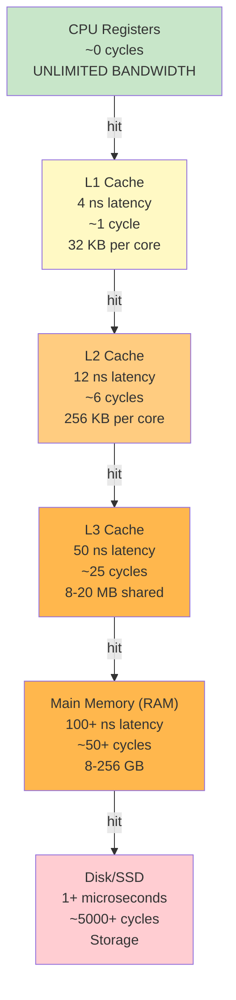
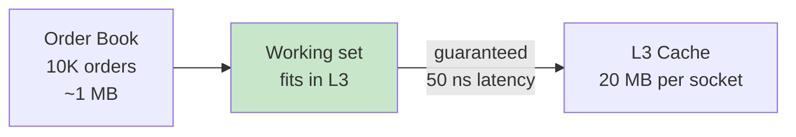
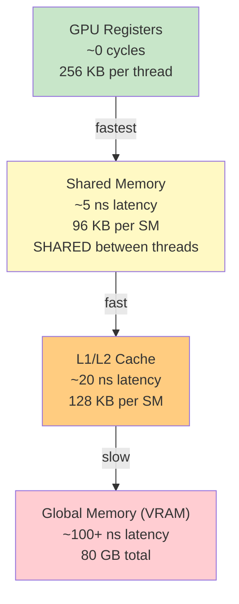

# CPU Cycles & Hardware Hierarchy: From Clock Speed to Latency

## First Principles: What is a CPU Cycle?

A CPU cycle is the fundamental unit of time on a processor. The **clock speed** (in GHz) tells you how many cycles happen per second.

```
Modern CPUs (2024):
  AMD Ryzen 7 7700X: 5.4 GHz (base), 5.6 GHz (boost)
  Intel Core i9-13900K: 5.8 GHz (base), 5.8 GHz (boost)
  Apple M3: 4.2 GHz (base)
  
What this means:
  1 GHz = 1 billion cycles per second
  5 GHz = 5 billion cycles per second
  
So: 1 cycle = 1 / (5 * 10^9) seconds = 0.2 nanoseconds
```

**How many operations fit in one cycle?**

Modern CPUs use **instruction-level parallelism (ILP)** and **pipelining**:
- **Pipelining:** While one instruction executes, the next is decoded, and the next is fetched (3+ stages in parallel).
- **Out-of-order execution:** CPU can execute independent instructions in any order (reordering for efficiency).
- **Superscalar execution:** Multiple instructions execute in the same cycle (e.g., one ALU operation + one load + one store = 3 instructions/cycle).

**Rule of thumb:**
- Ideal case: **4 instructions per cycle** (modern CPUs, good code)
- Realistic: **1-2 instructions per cycle** (data dependencies, cache misses stall the pipeline)
- Pessimal: **< 1 instruction per cycle** (long data dependency chain, branch misprediction)

---

## The Problem: You Have 1 Microsecond

Imagine you're building an order book. The latency budget is **1 microsecond (1 µs)**.

**How much can you do?**

```
1 microsecond = 1,000 nanoseconds
CPU clock = 5 GHz = 5 billion cycles/sec

Cycles available: 1 µs * 5 GHz = 5,000 cycles

At 4 instructions/cycle:
  Total instructions: 5,000 * 4 = 20,000 instructions
```

**That sounds like a lot, until you consider latency.**

---

## Memory Hierarchy: The Real Bottleneck

A CPU can execute an instruction, but **memory access is slow**. Different memory levels have different latencies:



**What this means:**

If you access data in L1 cache (4 ns), you're in **1 cycle** of waiting.
If you access main memory (100 ns), you're in **50 cycles** of waiting.

**Those 50 cycles are cycles where the CPU is STALLED** — it can't execute instructions that depend on that load.

---

## Real Example: Order Book Latency Budget (1 µs)

Breaking down where time goes:

```
Order arrives: "BUY 100 @ $101.50"

Step 1: Format validation (check it's valid JSON/protobuf)
  → CPU-bound: 20 instructions, no memory
  → Time: 20 instructions / 4 per cycle = 5 cycles = 1 ns
  → Latency: 1 ns

Step 2: Symbol table lookup (is "AAPL" a valid stock?)
  → Hash table lookup
  → If in L1 cache: 1 access = 4 ns = 1 cycle
  → If in L3 cache: 1 access = 50 ns = 25 cycles
  → If in main memory: 1 access = 100 ns = 50 cycles
  → Latency: 4–100 ns

Step 3: Find price level in order book (red-black tree)
  → Tree is 10K entries (not in cache)
  → log2(10K) = 13 tree traversals
  → Each traversal: load node from memory (100 ns)
  → Latency: 13 * 100 ns = 1300 ns (1.3 µs)
  
  ⚠️ PROBLEM: Just tree lookup EXCEEDS 1 µs budget!

Step 4: Match against counterparties (if cache misses continue)
  → More memory access
  → Can't finish in remaining time
```

**The issue:** Even a few **cache misses** can blow the latency budget.

---

## Cache Misses: The Hidden Cost

Most latency spikes are caused by **cache misses**. Let's model this:

```
Latency cost breakdown (empirical):

Action                          Time        Cycles (@ 5GHz)
─────────────────────────────────────────────────────────
Simple operation (add, shift)   0.2 ns      ~1
L1 cache hit                    4 ns        ~2
L2 cache hit                    12 ns       ~6
L3 cache hit                    50 ns       ~25
Main memory access              100 ns      ~50
Page fault (OS, disk)           10+ ms      ~50,000,000

Real example: Order book with 1M orders
─────────────────────────────────────────
Order arrives
  Validation: 1 ns
  Symbol lookup: 4 ns (L1 hit)
  Tree traverse (13 levels):
    - First 3 levels in L3: 50 ns each = 150 ns
    - Next 10 levels in memory: 100 ns each = 1000 ns
  Matching: 100 ns
  
Total: 1254 ns = 1.25 microseconds
P99.9 spike? One page fault = 10ms additional latency
```

---

## Strategy: Fit Everything in L3 Cache

To guarantee latency, design so **working set fits in cache**:



**Implication for design:**
- If order book is 100 MB, it DOESN'T fit in L3.
- Tree traversal will hit main memory → 50–100 ns per access → too slow.
- **Solution:** Use cache-friendly data structure (array instead of linked list, pre-allocate to control layout).

---

## H100 GPU Analogy (Same Principle)

The hierarchy is identical on GPUs, just with different names:



**GPU kernels optimize for the same reason:** reduce memory access latency by maximizing cache reuse.

---

## Deriving Your Constraints

**Given a latency budget, you can calculate:**

1. **How many CPU cycles do you have?**
   ```
   Cycles = Latency (ns) * Clock speed (GHz) / 1000
   
   Example: 1 µs budget, 5 GHz CPU
   Cycles = 1000 * 5 / 1000 = 5000 cycles
   ```

2. **How many instructions can you execute (best case)?**
   ```
   Instructions = Cycles * ILP
   
   Example: 5000 cycles * 4 ILP = 20,000 instructions
   ```

3. **How many cache misses can you afford?**
   ```
   Each L3 miss costs ~25 cycles.
   Budget: 5000 cycles.
   Max misses: 5000 / 25 = 200 misses
   
   If your algorithm has 1000 memory accesses:
   Hit rate required: (1000 - 200) / 1000 = 80%
   ```

4. **What data structure works?**
   ```
   If you use a linked list (1 cache miss per node):
     10 nodes = 10 misses = 250 cycles = 50 ns ✓
     100 nodes = 100 misses = 2500 cycles = 500 ns ✓
     1000 nodes = 1000 misses = 25000 cycles = 5000 ns ✗ (over budget)
   
   If you use an array (1 miss per 64 bytes = 8–16 integers):
     10 elements = 1 miss = 25 cycles = 5 ns ✓
     100 elements = 2 misses = 50 cycles = 10 ns ✓
     1000 elements = 16 misses = 400 cycles = 80 ns ✓
   ```

---

## Story Card: OrderBookEngine P99.9 Spike

**Setup:** Order book latency budget is P50 < 1 µs, P99.9 < 5 µs.

**Initial design:** Red-black tree with 1M orders, linked-list price levels.

**Measurement:**
```
perf report shows:
  L3 cache misses: 40% of memory accesses
  Main memory latency: 100+ ns per access
  P99.9: 8 µs (over budget)
```

**Root cause:** Tree traversal (13 levels) causes 5–7 cache misses per order.

**Fix:**
1. **Keep price levels in array** (contiguous memory, fewer misses).
2. **Pre-allocate order pool** so addresses are sequential (better cache locality).
3. **Use cache-line padding** to prevent false sharing across threads.

**Result:**
```
L3 cache hit rate: 95% (was 60%)
P99.9: 3 µs (now under budget)
```

**Key insight:** Latency is dominated by **cache misses, not CPU instructions**. The CPU could execute 20,000 instructions, but it's stalled waiting for memory.

---

## Reasoning Framework: "Where's the Time?"

When you have a latency budget and a system:

1. **Estimate ideal latency** (all L1 cache hits)
   - Order validation: 1 ns
   - Lookup: 4 ns
   - Total: 5 ns
   
2. **Estimate realistic latency** (some cache misses)
   - Validation: 1 ns
   - Tree lookup (assume 3 L3 hits): 50 * 3 = 150 ns
   - Total: 151 ns
   
3. **Measure actual latency** (ground truth)
   - perf report: P50 = 200 ns, P99 = 2 µs
   - ⚠️ Big gap. Something is worse than estimated.
   
4. **Investigate gap**
   - Flame graph: tree.find() is hot
   - Hardware counters: L3 miss rate 80%
   - Root cause: tree is too large, tree nodes scattered in memory
   
5. **Fix**
   - Reduce tree size (shard by symbol)
   - Or: use cache-friendly structure (array)
   - Or: pre-allocate to control memory layout

---

## Q&A (Built on Fundamentals)

**Recall 1:** A CPU has 5 GHz clock speed. You have a 1 microsecond latency budget. How many CPU cycles do you have?

*Must-say:*
- 1 µs = 1000 ns
- 5 GHz = 5 cycles per ns
- Cycles = 1000 * 5 = 5000 cycles

**Probe 1:** You're accessing elements in a linked list of 100 nodes. Each access is a cache miss (100 ns latency). How long does it take to traverse the list?

*Expected:*
- 100 accesses * 100 ns = 10 µs
- Answer: too slow for sub-microsecond constraint
- Alternative: use array (1 miss per 16 elements) = 6–7 misses = 600–700 ns

**Probe 2:** Your latency budget is 5 µs. You can afford 200 CPU cycles before hitting main memory. How many instructions can you execute?

*Expected:*
- At 4 ILP: 200 * 4 = 800 instructions
- If you have 1000 instructions, you'll stall waiting for memory
- Either reduce instructions or ensure data is in cache

**Numeric 1:** An order book has 10K orders (red-black tree). Tree height is log2(10K) ≈ 13 levels. If each tree node is scattered in memory (cache miss), and each miss costs 100 ns, how long to traverse the tree?

*Working:*
- 13 levels * 100 ns = 1300 ns
- Latency budget is 1 µs = 1000 ns
- Over budget by 300 ns
- Solution: reduce misses (fit tree in cache, or use different structure)

**Numeric 2:** GPU memory bandwidth is 2 TB/s. You need to read 1 GB of data. How long?

*Working:*
- 1 GB = 1000 MB
- 2 TB/s = 2000 MB/s
- Time = 1000 / 2000 = 0.5 seconds
- This is why GPU kernels optimize memory access patterns

---

## Questions for the Interviewer

- How do you measure cache misses in your system? (perf, custom instrumentation?)
- Have you had to redesign a data structure to fit in cache?
- How do you trade off latency vs throughput given hardware constraints?
- What's your latency budget, and what are the dominant contributors to P99.9?
