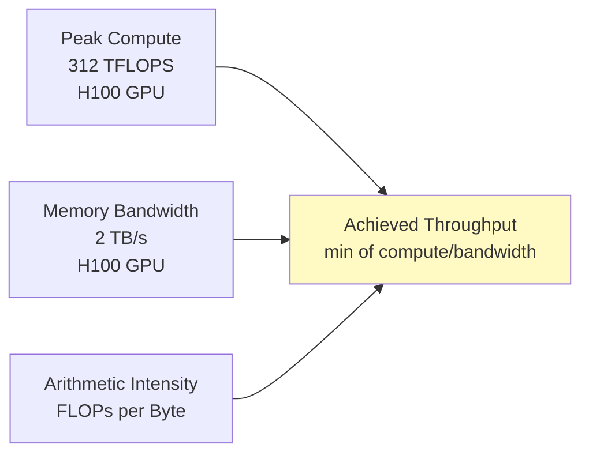
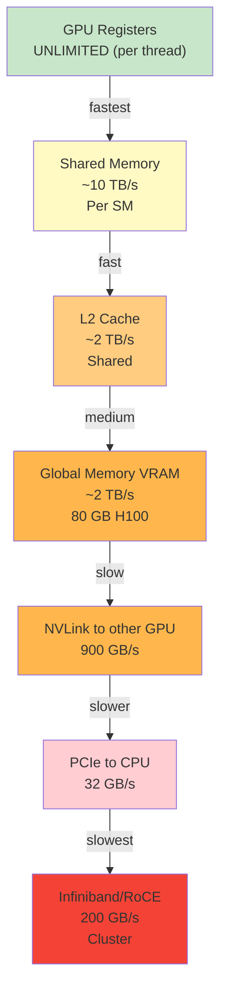

# Memory Hierarchy & Bandwidth: Cache, Arithmetic Intensity, Roofline Model

## First Principle: Bandwidth = Throughput

**Bandwidth** is how much data can move per second.

```
Example: NVLink between two GPUs
  Bandwidth: 900 GB/s (gigabytes per second)
  
What this means:
  In 1 second, 900 billion bytes can move
  In 1 millisecond, 900 million bytes (900 MB)
  In 1 microsecond, 900 KB
```

**Why does bandwidth matter?**

If your algorithm moves lots of data, bandwidth is your bottleneck.

```
Example: Matrix transpose
  Read 1 billion floats (4 GB)
  Write 1 billion floats (4 GB)
  Total: 8 GB moved
  
  On NVLink (900 GB/s): 8 GB / 900 GB/s = 8.9 ms
  On PCIe (32 GB/s): 8 GB / 32 GB/s = 250 ms
  
  PCIe is 28x slower (same operation)
```

---

## Arithmetic Intensity: FLOPs per Byte

**Arithmetic intensity** measures how much computation happens per byte of data moved.

```
Arithmetic Intensity (AI) = FLOPs / Bytes Transferred

Example 1: Simple add
  for (int i = 0; i < n; ++i)
    c[i] = a[i] + b[i];
  
  FLOPs: n (one add per iteration)
  Bytes: 3n floats (read a[i], read b[i], write c[i]) * 4 bytes = 12n bytes
  AI = n / 12n = 1/12 FLOP/byte
  
Example 2: Matrix multiply
  C = A * B (512x512)
  
  FLOPs: 512 * 512 * 512 * 2 (MAC) = 256M FLOPs
  Bytes: 512*512 floats read from A + B + 512*512 written to C = 1.5M floats * 4 = 6M bytes
  AI = 256M / 6M = 42 FLOPs/byte (HIGH)
  
Example 3: Stencil (image filter)
  for each pixel:
    output = sum of 9 neighbors (one 3x3 box)
  
  FLOPs: 9 adds per pixel
  Bytes: 9 reads (9 neighbors) * 4 bytes = 36 bytes
  AI = 9 / 36 = 0.25 FLOPs/byte (LOW)
```

---

## The Roofline Model: Finding Your Bottleneck

**Roofline model** shows whether your code is **compute-bound** or **memory-bound**.

The idea: your throughput is limited by either:
1. **Peak compute** (GFLOPs/s), or
2. **Bandwidth** (GB/s) * arithmetic intensity

```
Throughput = min(Peak Compute, Bandwidth * Arithmetic Intensity)
```

**Visual:**



**Deriving the boundary:**

```
When is compute the bottleneck?
  Peak Compute = Bandwidth * AI
  312 TFLOPS = 2 TB/s * AI
  312 * 10^12 FLOPS/s = 2 * 10^12 bytes/s * AI
  AI = 312 / 2 = 156 FLOPS/byte
  
When AI > 156: compute is the bottleneck (you can't feed the GPU fast enough)
When AI < 156: memory is the bottleneck (you're waiting for data)
```

**The roofline diagram:**

```
Throughput (FLOPS)
       |
312T   |────────── COMPUTE BOUND (peak compute)
       |╱
       |╱ Memory-bound region (slope = bandwidth)
       |╱
      0+────────────────── Arithmetic Intensity (FLOPS/byte)
       0                  156
```

**Concrete examples:**

```
Example 1: Simple add (AI = 1/12)
  ├─ Peak compute: 312 TFLOPS
  ├─ Bandwidth * AI: 2 TB/s * (1/12) FLOPS/byte = 166 GFLOPS
  └─ Achieved throughput: min(312T, 166G) = 166G (MEMORY-BOUND)
  
Example 2: Matrix multiply (AI = 42)
  ├─ Peak compute: 312 TFLOPS
  ├─ Bandwidth * AI: 2 TB/s * 42 FLOPS/byte = 84 TFLOPS
  └─ Achieved throughput: min(312T, 84T) = 84T (MEMORY-BOUND, but better)
  
Example 3: Small matrix multiply (fits in shared memory, AI = 200)
  ├─ Peak compute: 312 TFLOPS
  ├─ Bandwidth * AI: 2 TB/s * 200 FLOPS/byte = 400 TFLOPS
  └─ Achieved throughput: min(312T, 400T) = 312T (COMPUTE-BOUND, full GPU)
```

---

## Real Example: Attention Kernel (KV-Cache)

**Problem:** Computing attention for vLLM inference.

```
Input:
  Q (query): 1 token (128 dimensions) * 2 bytes = 256 bytes
  K (key): 4K context (128 dims) * 2 bytes = 1 MB
  V (value): 4K context (128 dims) * 2 bytes = 1 MB
  
Computation:
  scores = Q @ K^T → 1 x 4K matmul
  attn_weights = softmax(scores) → 4K values
  output = attn_weights @ V → 4K x 128 matmul
  
FLOPs:
  Q @ K^T: 1 * 4K * 128 * 2 = 1M FLOPs
  softmax: 4K * 10 ops = 40K FLOPs
  attn @ V: 4K * 128 * 2 = 1M FLOPs
  Total: ~2M FLOPs

Data movement:
  Read Q: 256 bytes
  Read K: 1 MB
  Read V: 1 MB
  Write output: 128 * 2 = 256 bytes
  Total: 2M bytes
  
Arithmetic Intensity:
  AI = 2M FLOPs / 2M bytes = 1 FLOP/byte
  
Analysis:
  Bandwidth * AI: 2 TB/s * 1 = 2 TFLOPS (MEMORY-BOUND)
  Peak compute: 312 TFLOPS
  Bottleneck: MEMORY (K and V fetches dominate)
  
Solution:
  Reduce data movement by caching K and V in shared memory
  Or: use KV-cache quantization (4x less memory)
```

---

## Why Decode is Slow (vLLM Example)

```
Prefill (processing prompt):
  Q: 4K tokens, K: 4K tokens, V: 4K tokens
  Matrix size: 4K x 4K attention
  AI = 8 FLOPs/byte (compute-bound)
  GPU utilization: 100%
  Time: 100ms
  
Decode (generating next token):
  Q: 1 token, K: 4K tokens, V: 4K tokens
  Matrix size: 1 x 4K attention
  AI = 1 FLOP/byte (memory-bound)
  GPU utilization: 10%
  Time: 10ms per token
  
Insight: Decode reads 4K context but only computes 1 token.
         Most of the GPU sits idle waiting for memory.
         This is why batching helps: batch 32 tokens, 32x more compute on same memory.
```

---

## Bandwidth Hierarchy (Different Levels)



**Implication:** Optimize in order of urgency:
1. Minimize global memory accesses (most common bottleneck)
2. Maximize shared memory reuse
3. Avoid PCIe/network transfers if possible

---

## Strategy: Roofline-Driven Optimization

Given a kernel that's memory-bound:

**Option 1: Increase arithmetic intensity**
```
Original: AI = 1 FLOP/byte (memory-bound)
Goal: AI > 156 (to become compute-bound)

Strategy: Reduce memory transfers
  Use shared memory to cache data (reuse)
  Fuse operations (combine multiple kernels)
  Example: fuse attention + linear projection
    Before: attention reads V (1M), writes (256), linear reads output (256), writes (256)
    After: attention computes, passes directly to linear (avoids 256 byte write/read)
    Memory saved: 256 bytes per token
```

**Option 2: Reduce data movement**
```
Example: KV-cache quantization
  Before: 4K context * 128 dims * 2 bytes = 1 MB per request
  After: 4K context * 128 dims * 0.5 bytes (INT8) = 0.25 MB
  Bandwidth savings: 4x
  New AI: 1 FLOP/byte * 4 = 4 FLOPs/byte (still memory-bound, but better)
```

**Option 3: Batch to hide latency**
```
Single token: 1 token, AI = 1, throughput = 2 GFLOPS (10% GPU)
Batch 32: 32 tokens, AI = 32, throughput = 64 GFLOPS (100% GPU)
  Same memory bandwidth, but amortized across more compute
```

---

## Story Card: vLLM Continuous Batching

**Setup:** vLLM serves Llama-70B. Decode is memory-bound (10% GPU utilization).

**Problem:** 1 token at a time → 10% utilization → can serve ~10 requests/sec at $100/hr.

**Solution:** Continuous batching
```
Old: Process 1 token per batch
  Memory: 1 token, K 4K (1 MB), V 4K (1 MB) → AI = 1
  Throughput: 2 GFLOPS
  Time: 5 ms per batch
  
New: Process 32 tokens per batch
  Memory: 32 tokens, K 4K (1 MB), V 4K (1 MB) → AI = 32
  Throughput: 64 GFLOPS (same memory bandwidth, 32x more FLOPS)
  Time: 5 ms per batch (still limited by K/V fetch)
  But now process 32 tokens in 5 ms = 6.4 tokens/ms = 32 requests/sec
  
Improvement: 3.2x more throughput, 100% GPU utilization
```

**Key insight:** Roofline told us the bottleneck. Continuous batching increases AI, saturating the GPU.

---

## Q&A (Built on Fundamentals)

**Recall 1:** What is arithmetic intensity? Give an example where it's high (> 10) and low (< 1).

*Must-say:*
- Arithmetic intensity = FLOPs / bytes moved
- High: matrix multiply (many FLOPs per byte)
- Low: memory copy (1 FLOP per byte... actually 0, just copying)

**Probe 1:** A kernel has AI = 0.5 FLOPS/byte. GPU bandwidth is 2 TB/s. Peak compute is 312 TFLOPS. What's your bottleneck?

*Expected:*
- Bandwidth * AI = 2 TB/s * 0.5 = 1 TFLOPS
- Peak compute: 312 TFLOPS
- min(1T, 312T) = 1T → MEMORY-BOUND
- Optimization: reduce memory transfers (quantization, caching)

**Probe 2:** You're implementing an attention kernel. Prefill is compute-bound (100% GPU). Decode is memory-bound (10% GPU). Why? How do you fix it?

*Expected:*
- Prefill: batched matmul (many tokens * many tokens = high AI)
- Decode: 1 token * many tokens = low AI (memory-bound)
- Fix: batch decode (continuous batching, multiple requests)

**Numeric 1:** Matrix multiply: A is 512x512, B is 512x512, C = A*B. How many FLOPs? How many bytes moved?

*Working:*
- FLOPs: 512 * 512 * 512 * 2 = 268M FLOPs
- Bytes: 512*512 floats from A (1M) + 512*512 from B (1M) + output (1M) = 3M floats * 4 = 12M bytes
- AI = 268M / 12M = 22 FLOPs/byte
- Bandwidth * AI = 2 TB/s * 22 = 44 TFLOPS (memory-bound)

**Numeric 2:** Decode: 1 query token, 4K context. Attention is 1x4K matmul. FLOPs?

*Working:*
- FLOPs: 1 * 4K * 128 * 2 = 1M FLOPs
- Bytes: 1 query (256B) + 4K context K (1M) + 4K context V (1M) = 2M bytes
- AI = 1M / 2M = 0.5 FLOPs/byte (very memory-bound)

---

## Questions for the Interviewer

- How do you measure roofline for your kernels? (NVIDIA Nsight, custom profiling?)
- Have you optimized a memory-bound kernel by increasing arithmetic intensity?
- In your system, what's the AI of the critical path? (compute vs memory bound?)
- How do you handle kernels that are memory-bound but can't be batched further?
