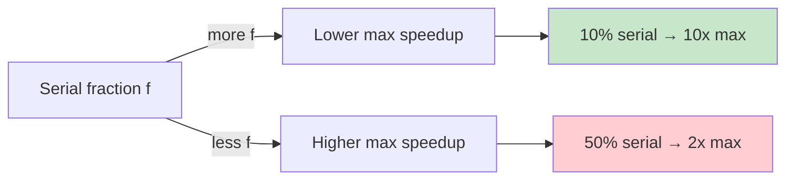

# Amdahl's Law & Scaling: Why 2x GPUs ≠ 2x Speedup

## The Problem: Why Doesn't Scaling Work?

You have one GPU. Training takes 10 hours.

You get 2 GPUs. Do you expect 5 hours?

**Reality:** 6 hours. You only got 1.67x speedup, not 2x.

**Why?** Some parts of training parallelize. Some don't. And communication overhead grows.

---

## First Principle: Serial vs Parallel Portions

Every program has portions that **must run serially** (no parallelization possible) and portions that **can run in parallel**.

```
Serial: initialization, gathering data, some model operations
Parallel: matrix multiply (can split across GPUs), forward pass (mostly parallel)

Example: Training 70B model on 8 GPUs

Total time = 10 hours

Serial portions (can't parallelize):
  - Data loading: 10 minutes (must happen once, per batch)
  - Model init: 5 minutes (once)
  - Gradient computation (some gather operations that need synchronization)
  - Allreduce (all GPUs must sync): 30% of time
  
Parallel portions (scale with more GPUs):
  - Forward pass: 30% of time
  - Backward pass: 40% of time
```

**Key insight:** The *serial* portions limit your speedup.

---

## Amdahl's Law: The Math

Let's say:
- **f** = fraction of time spent in serial portions (0 ≤ f ≤ 1)
- **1 - f** = fraction of time spent in parallel portions
- **p** = number of GPUs (parallelism level)

**Speedup formula:**

```
Speedup(p) = 1 / (f + (1-f)/p)

Where:
  f = serial fraction (constant, doesn't benefit from parallelism)
  (1-f)/p = parallel fraction, divided by number of GPUs
```

**Examples:**

```
Case 1: 20% serial, 80% parallel
  f = 0.2
  
  1 GPU: Speedup = 1 / (0.2 + 0.8/1) = 1 / 1.0 = 1x
  2 GPUs: Speedup = 1 / (0.2 + 0.8/2) = 1 / 0.6 = 1.67x
  4 GPUs: Speedup = 1 / (0.2 + 0.8/4) = 1 / 0.4 = 2.5x
  8 GPUs: Speedup = 1 / (0.2 + 0.8/8) = 1 / 0.225 = 4.4x
  ∞ GPUs: Speedup = 1 / 0.2 = 5x (limited by serial fraction)

Case 2: 50% serial, 50% parallel (bad parallelization)
  f = 0.5
  
  1 GPU: Speedup = 1x
  2 GPUs: Speedup = 1 / (0.5 + 0.5/2) = 1.33x
  4 GPUs: Speedup = 1 / (0.5 + 0.5/4) = 1.6x
  8 GPUs: Speedup = 1 / (0.5 + 0.5/8) = 1.78x
  ∞ GPUs: Speedup = 2x (limited by serial fraction)
```

**The limit:** As p → ∞, speedup approaches 1/f. If 20% is serial, max speedup is 5x no matter how many GPUs.

---

## Visualization: Speedup Curve



**Speedup vs number of GPUs:**

```
Speedup
    |
10x |       f=10%
    |      /
 5x |  ---●----- f=20%
    | /
 2x |●----------- f=50%
    |
 1x |
    +────────────────── Number of GPUs
     1   2   4   8  16  32
```

**Key insight:** The curve is flat for high-serial-fraction systems. Adding more GPUs doesn't help much.

---

## Real Example: GPU Flight Recorder (Your Project)

**Setup:** Distributed GPU training. 8 GPUs, detecting stragglers using NCCL collective timings + NVML telemetry.

**Expected:** 8 GPUs = 8x speedup (ideal parallelism).

**Actual measurement:** 1.5x speedup. Why?

```
Training timeline breakdown:

Serial portions:
  Coordinator gathering NCCL metrics: 100 ms (can't parallelize)
  Allreduce (synchronization): each GPU waits for all others
  Clock skew correction: must measure all GPUs first
  
Parallel portions:
  Gradient computation: parallelizable across GPUs
  Forward/backward pass: mostly parallel
  
Fraction analysis:
  
  Allreduce on ring:
    - Ring bandwidth: min(NVLink, worst link)
    - 80 GB data, 900 GB/s NVLink → 88 ms per allreduce
    - 100 backward passes per training step → 8800 ms allreduce
    
  Forward/backward (parallel):
    - Per GPU: 5000 ms (same on each GPU in parallel)
  
  Total per step:
    Serial (allreduce): 8800 ms
    Parallel: 5000 ms
    
  f = 8800 / (8800 + 5000) = 8800 / 13800 = 0.64 (64% serial!)
  
  Speedup = 1 / (0.64 + 0.36/8) = 1 / (0.64 + 0.045) = 1 / 0.685 = 1.46x ≈ 1.5x
```

**The bottleneck:** Allreduce communication is the serial portion. Even with 8 GPUs, each GPU must wait for all others to synchronize.

**How to improve:**
1. **Reduce allreduce frequency** (accumulate gradients, sync every N steps)
2. **Use faster network** (NVLink 900 GB/s vs Infiniband 200 GB/s)
3. **Overlap communication with computation** (start next forward pass while allreduce is in flight)
4. **Ring allreduce optimization** (bandwidth-optimal but latency high)

---

## Communication Overhead: The Hidden Serial Fraction

When you scale to multiple GPUs, communication becomes a major cost.

```
Single GPU:
  Forward: 1000 ms
  Backward: 2000 ms
  Update: 100 ms
  Total: 3100 ms

8 GPUs (naive allgather):
  Forward (parallel): 1000 ms / 8 = 125 ms
  Backward (parallel): 2000 ms / 8 = 250 ms
  Allgather (serial): 500 ms (all-to-all communication)
  Update (parallel): 100 ms / 8 = 12.5 ms
  Total: 125 + 250 + 500 + 12.5 = 887.5 ms
  
  Expected speedup: 3100 / 887.5 = 3.5x (ideal: 8x)
  
8 GPUs (ring allreduce, optimized):
  Forward (parallel): 125 ms
  Backward (parallel): 250 ms
  Ring allreduce (optimized): 200 ms (instead of 500)
  Update (parallel): 12.5 ms
  Total: 587.5 ms
  
  Speedup: 3100 / 587.5 = 5.3x (better, but still < 8x)
```

**Why ring allreduce is better:**
- Allgather: O(N²) messages (each GPU talks to all others)
- Ring: O(N) phases, one message per phase
- Bandwidth-optimal: each link used exactly once

---

## When Does Adding More Help? (Saturation Analysis)

```
Question: You're training on 4 GPUs with 30% allreduce time.
Should you scale to 8 GPUs?

f_current = 0.30
Speedup(4) = 1 / (0.30 + 0.70/4) = 1 / 0.475 = 2.1x

f_future = 0.40 (allreduce fraction grows as you scale)
Speedup(8) = 1 / (0.40 + 0.60/8) = 1 / 0.475 = 2.1x

Answer: NO. Speedup stays the same because allreduce fraction grows.
You're hitting the "saturation point" where communication dominates.
```

**Saturation curve:**

```
Speedup
    |
 8x |
    |      Ideal (f=0)
 6x |    /
    |  /
 4x | / ← Actual (f grows with scale)
    |/
 2x |●───●───● (flat, communication dominates)
    |
    +─────────────
     1   2   4   8  16
     
Insight: beyond some point (here, 4 GPUs), adding more doesn't help.
```

---

## Story Card: GPU Flight Recorder Scaling Analysis

**Setup:** You built GPU Flight Recorder. Initially tested on 4 GPUs with 1.8x speedup. Scaled to 8 GPUs, expecting 3.6x. Got only 1.5x.

**Investigation:**

1. **Measure allreduce cost:**
   - PyTorch NCCL profiler: allreduce takes 88 ms per step
   - Backward pass takes 50 ms per step (parallel)
   - **f = 88 / (88 + 50) = 0.64**

2. **Apply Amdahl's law:**
   - Speedup(8) = 1 / (0.64 + 0.36/8) = 1.46x
   - Matches observed 1.5x ✓

3. **Root cause:** Ring allreduce bandwidth-optimal but **latency-bound**.
   - Data: 80 GB
   - NVLink: 900 GB/s
   - Time: 88 ms (unavoidable on ring topology)
   - Solution: use 2D mesh (multiple rings) or GPU-direct RDMA (Infiniband)

4. **Fix decision:**
   - Upgrade to Infiniband: 200 GB/s → 400 ms allreduce (worse!)
   - Or: reduce gradient size (gradient accumulation, compression)
   - Or: accept 1.5x as the saturation point and focus on other optimizations

**Key insight:** Amdahl's law predicted the bottleneck before measurement. Communication, not compute, limits scaling.

---

## The Cost of Communication

Different networks have different costs:

```
Network              Bandwidth    Latency    Distance
─────────────────────────────────────────────────────
GPU Registers        UNLIMITED    < 1 ns     Per thread
Shared Memory        10 TB/s      5 ns       Per SM
L2 Cache             2 TB/s       20 ns      Per GPU
Global Memory        2 TB/s       100 ns     1 GPU
NVLink               900 GB/s     2 µs       8 GPUs
PCIe                 32 GB/s      10 µs      1 machine
Infiniband/RoCE      200 GB/s     1 µs       Cluster
Ethernet             10 GB/s      100 µs     Internet
```

**Implication:** Allreduce cost grows with network distance.

```
8 GPUs same machine (NVLink): 88 ms
8 GPUs on PCIe-connected: 500 ms
8 GPUs in cluster (Infiniband): 150 ms
```

---

## Reasoning Framework: "Will This Scale?"

Given a system with serial fraction **f** and **p** GPUs:

1. **Calculate current speedup:**
   ```
   Speedup = 1 / (f + (1-f)/p)
   ```

2. **Calculate theoretical max:**
   ```
   Max speedup = 1 / f (as p → ∞)
   ```

3. **Decide: add more GPUs?**
   ```
   If Speedup(p) is close to max (> 80%):
     → No, you're hitting diminishing returns
   If Speedup(p) is far from max (< 50%):
     → Maybe, if you can reduce f (optimize communication)
   ```

4. **Identify bottleneck:**
   ```
   If f is growing with p:
     → Communication is the bottleneck (allreduce, gradient sync)
     → Solution: reduce synchronization frequency, compress gradients, use faster network
   If f is constant:
     → Serial code is the bottleneck (data loading, model init)
     → Solution: parallelize initialization, async data loading
   ```

---

## Q&A (Built on Amdahl's Law)

**Recall 1:** What is Amdahl's law? Why does it matter?

*Must-say:*
- Speedup = 1 / (f + (1-f)/p), where f is serial fraction.
- Even with infinite GPUs, speedup is limited to 1/f.
- You can't parallelize serial code, so it limits your scaling.

**Probe 1:** You have 4 GPUs with 40% serial fraction. You add 4 more GPUs. What's the new speedup?

*Expected:*
- Current (4 GPUs): Speedup = 1 / (0.4 + 0.6/4) = 1 / 0.55 = 1.82x
- New (8 GPUs): Speedup = 1 / (0.4 + 0.6/8) = 1 / 0.475 = 2.1x
- Improvement: 2.1 / 1.82 = 1.15x (only 15% gain for 2x more GPUs, diminishing returns)

**Probe 2:** Allreduce takes 100 ms. Backward pass takes 50 ms (parallel on 8 GPUs). Should you scale to 16 GPUs?

*Expected:*
- f = 100 / (100 + 50) = 0.67
- Speedup(8) = 1 / (0.67 + 0.33/8) = 1.37x
- Speedup(16) = 1 / (0.67 + 0.33/16) = 1.48x
- Gain: only 8% for 2x more hardware. Likely not worth it unless allreduce can be optimized.

**Numeric 1:** You have f = 0.1 (10% serial). How much speedup with 10 GPUs?

*Working:*
- Speedup = 1 / (0.1 + 0.9/10) = 1 / (0.1 + 0.09) = 1 / 0.19 = 5.26x
- Max speedup (∞ GPUs) = 1 / 0.1 = 10x
- You're at 52.6% of max efficiency.

**Numeric 2:** Allreduce is 40% of training time. Computation is 60%. f = 0.4. Speedup(4)?

*Working:*
- Speedup = 1 / (0.4 + 0.6/4) = 1 / (0.4 + 0.15) = 1 / 0.55 = 1.82x
- Not great for 4 GPUs (should be closer to 3–4x if f were lower).

---

## Questions for the Interviewer

- How do you measure serial fraction in your system? (profiling, tracing?)
- Have you hit Amdahl's law saturation? (beyond N GPUs, scaling stops helping)
- Is your bottleneck computation or communication? How do you know?
- How do you decide whether to scale horizontally (more GPUs) or vertically (faster GPUs)?
