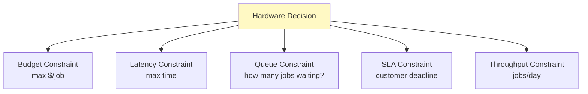

# Cost-Latency Trade-offs: SLA, Hardware Choice, Operating Points

## The Problem: Pick Your Hardware

You need to train a 70B model. You have three options:

**Option A:** 32 A100 GPUs ($3/hr) — slow but cheap
- Training time: 100 hours
- Cost: 32 * 100 * $3 = **$9,600**

**Option B:** 16 H100 GPUs ($20/hr) — fast but expensive
- Training time: 50 hours
- Cost: 16 * 50 * $20 = **$16,000**

**Option C:** 8 H100 GPUs ($20/hr) — slower, cheaper
- Training time: 80 hours
- Cost: 8 * 80 * $20 = **$12,800**

**Question:** Which is optimal? It depends on constraints you don't have yet.

---

## First Principle: Cost vs Speed Trade-off

**Hardware options have two dimensions:**
- **Cost per unit time:** $/hour
- **Speed:** hours to completion

```
Cheap, slow:    A100 $3/hr, 100 hours = $300 total
Expensive, fast: H100 $20/hr, 50 hours = $1000 total

Constraint 1: Budget is $500
  → Only A100 works (even at max)
Constraint 2: Must finish in 60 hours
  → H100 or equivalent (A100 takes 100 hours)
Constraint 3: Cost per hour (not total cost)
  → Use cheapest (A100 $3/hr)
Constraint 4: Cost per job (minimize total spend)
  → Might be H100 if it finishes faster and other jobs queue behind it
```

**Key insight:** Optimal choice depends on **what you're optimizing for**.

---

## Real Constraints in Production



**Scenario 1: Budget-constrained (startup)**
```
Budget: $1000/month for training
Options:
  A100 (8 GPU): 100 hours * $3 = $300 → can train 3x per month
  H100 (8 GPU): 50 hours * $20 = $800 → can train 1x per month
  
Choice: A100 (train more models on same budget)
```

**Scenario 2: Latency-constrained (customer deadline)**
```
Deadline: 48 hours
Options:
  A100: 100 hours (MISS deadline)
  H100: 50 hours (MEET deadline)
  
Choice: H100 (only option that works)
```

**Scenario 3: Throughput-constrained (queue of jobs)**
```
Queue: 10 training jobs waiting
Job duration: 100 hours (A100) vs 50 hours (H100)

With A100 (100 hours/job):
  Avg job wait: 50 hours (5 jobs ahead)
  Satisfaction: low
  
With H100 (50 hours/job):
  Avg job wait: 25 hours (5 jobs ahead)
  Satisfaction: high
  
Choice: H100 (improves queue throughput, higher customer satisfaction)
```

---

## Cost-Latency Frontier: Pareto Optimality

**Not all hardware choices are sensible.** Some are strictly dominated:

```
Option          Cost/Job    Time    Cost/Token
─────────────────────────────────────────────
A100 8 GPU      $300        100h    $1.50
A100 16 GPU     $600        50h     $3.00    ← worse than H100, more cost
H100 8 GPU      $800        50h     $4.00
H100 16 GPU     $1600       25h     $8.00    ← more cost, less time
RTX 4090 1 GPU  $50         2000h   $0.025   ← slow but cheap
```

**Pareto frontier** (optimal points):

```
Cost/Job vs Time

$1600 |                          ●
      |                       (H100 16GPU)
$800  |                    ●
      |                (H100 8GPU)
$300  |              ●
      |           (A100 8GPU)
      |
  $50 |  ●                       (RTX4090, too slow)
      |
      +─────────────────────────
        0    50   100  150  200  (hours)
        
Frontier: RTX4090 → A100 8GPU → H100 8GPU → H100 16GPU
(not A100 16GPU, it's strictly worse than H100 8GPU)
```

**Optimal choice:** On the frontier, pick based on your constraint.

```
Budget $400?  → A100 8GPU
Budget $900?  → H100 8GPU
Deadline 30h? → H100 16GPU
```

---

## Cost Per Unit Output: $/Token (Inference)

In production serving, you care about **cost per inference request** or **cost per generated token**.

```
Model: Llama-70B
Inference: 1 prompt (100 tokens) → 100 output tokens (200 total)

Option A: 1 A100 GPU ($0.50/hr)
  Throughput: 10 requests/hour (10 second latency)
  Cost/request: $0.50 / 10 = $0.05
  Cost/token: $0.05 / 200 = $0.00025

Option B: 1 H100 GPU ($3.00/hr)
  Throughput: 20 requests/hour (3 second latency)
  Cost/request: $3.00 / 20 = $0.15
  Cost/token: $0.15 / 200 = $0.00075
  
Option C: 4 A100 GPUs with batching ($2.00/hr)
  Throughput: 100 requests/hour (batched)
  Cost/request: $2.00 / 100 = $0.02
  Cost/token: $0.02 / 200 = $0.0001
```

**Cost frontier for inference:**

```
$/Token vs Latency (P50)

$0.001 |
       |  ●
$0.0005|●  (1 A100, batched)
       |    
$0.0001|●                    (4 A100, batched)
       |        ●            (1 H100, batched)
       |
       +─────────────────
         0.1  1  10  100  (latency in seconds)
```

**Implication:** For inference, **batching + cheap hardware** dominates. H100 is only needed if latency SLA is strict (< 100 ms).

---

## SLA-Driven Hardware Choice

An **SLA** (Service Level Agreement) constrains latency.

```
Requirement: P50 latency < 100 ms

Option A: 1 H100 (3 second latency)
  ✗ MISS SLA
  
Option B: 1 H100 with batching (optimized kernel)
  → 1 second P50
  ✗ MISS SLA
  
Option C: 1 H100 + speculative decoding (shorter sequences)
  → 100 ms P50
  ✓ MEET SLA
  
Option D: Multiple H100 (parallel inference servers)
  → 100 ms P50 even without optimization
  ✓ MEET SLA
  
Cost comparison:
  Option C: 1 * $20/hr = $20/hr
  Option D: 4 * $20/hr = $80/hr
  
Choice: Option C (meets SLA with lower cost)
```

---

## Real Example: Training Llama-70B (Decision Matrix)

You need to train Llama-70B. Constraints:

1. **Scenario: Well-funded startup (no latency constraint)**
   ```
   Goal: minimize cost
   Options:
     A100 32 GPU: 100 hours, $9600
     H100 16 GPU: 50 hours, $16000
     A100 64 GPU: 50 hours, $19200
   
   Choice: A100 32 GPU (cheapest, acceptable timeline)
   ```

2. **Scenario: Research lab (deadline in 3 weeks)**
   ```
   Deadline: 21 days = 504 hours
   Options:
     A100 8 GPU: 1000 hours (MISS)
     A100 32 GPU: 100 hours ✓
     H100 32 GPU: 50 hours ✓
     
   Within deadline: A100 32 GPU ($9600) or H100 16 GPU ($16000)
   Choice: A100 32 GPU (meets deadline, lower cost)
   ```

3. **Scenario: Production (train model monthly, serve existing models)**
   ```
   Monthly budget: $30000
   Competing with inference serving (needs GPUs too)
   
   Training cost must be < $10000 to leave room for serving
   Options:
     A100 8 GPU: 1000 hours (TOO SLOW, monthly deadline)
     A100 32 GPU: 100 hours, $9600 ✓
     A100 64 GPU: 50 hours, $19200 (OVER BUDGET)
     
   Choice: A100 32 GPU (meets timeline + budget)
   ```

4. **Scenario: Inference (already trained, serving customers)**
   ```
   SLA: P50 < 200 ms, P99 < 1 second
   Throughput: 1000 requests/second
   Cost limit: $1/second
   
   Option A: 10 H100 ($20/hr each) = $200/hr = $0.056/sec
     Throughput: ~100 req/sec per H100 = 1000 total ✓
     Latency: ~50 ms P50 ✓
     Cost: $0.056/sec ✓
   
   Option B: 50 A100 ($3/hr each) = $150/hr = $0.042/sec
     Throughput: ~20 req/sec per A100 = 1000 total ✓
     Latency: ~500 ms P50 ✗ (MISS SLA)
   
   Choice: H100 (only option meeting SLA)
   ```

---

## Optimization: Picking the Sweet Spot

Given multiple constraints, find the **sweet spot** that satisfies all:

```
Constraints:
  - Budget: < $20000
  - Deadline: < 60 days
  - SLA (inference afterward): P50 < 200 ms

Candidates:
  A100 64 GPU: 50 hours, $19200 cost, but inference slow
  H100 32 GPU: 25 hours, $20000 cost, inference fast ✓
  H100 16 GPU: 50 hours, $16000 cost, inference fast ✓

Feasible: H100 16 GPU ($16000, meets all constraints)
Pareto optimal: H100 32 GPU ($20000, stricter SLA margin)

Decision: H100 16 GPU (lower cost, still meets constraints)
```

---

## Story Card: Infrastructure Scaling Decision at Anthropic

**Setup:** Training Claude. Initial model took 100 hours on 64 A100 GPUs ($19,200).

Next iteration needed 2x training time (200 hours). Options:

1. **Option A: Scale A100**
   - 128 A100 GPUs: 100 hours, $38,400
   - Problem: A100s becoming hard to allocate (industry demand)
   - Allreduce time grows, scaling benefit diminishes (Amdahl's law)

2. **Option B: Switch to H100**
   - 64 H100 GPUs: 60 hours, $48,000
   - Better scaling (newer interconnect, NVLink)
   - But higher cost per unit

3. **Option C: Hybrid**
   - 32 H100 + 64 A100: 80 hours, $35,000
   - Mixed utilization (harder to manage)

4. **Option D: Accept longer time**
   - 64 A100 GPUs: 200 hours, $19,200
   - Deadline is flexible

**Decision factors:**
- **Amdahl's law:** Allreduce on 128 A100s would be f=0.5, speedup only 1.5x (not linear)
- **Cost frontier:** H100 at 64 units is more efficient than A100 at 128
- **Availability:** A100 supply constrained, H100 more available
- **Timeline:** Can we wait 200 hours? (if training every month, yes)

**Choice:** Option D (64 A100, accept 200 hours)
- Reasoning: Amdahl's law showed 128 units not worth it, cost is better at 64, timeline is acceptable

**Key insight:** Reasoning about scaling + cost = smarter hardware decisions than "just buy more GPU."

---

## Reasoning Framework: "Is This Hardware Choice Optimal?"

Given a decision:

1. **Identify constraints:**
   ```
   Budget? Latency SLA? Throughput target? Deadline?
   ```

2. **Generate options:**
   ```
   Different GPU counts, types, configurations
   Calculate cost and performance for each
   ```

3. **Filter feasible solutions:**
   ```
   Which options meet ALL constraints?
   ```

4. **Plot Pareto frontier:**
   ```
   Cost vs latency / cost vs throughput
   Which points are non-dominated?
   ```

5. **Choose from frontier:**
   ```
   On the frontier, pick lowest cost if all constraints met
   Or pick lowest latency if cost flexible
   ```

6. **Check with Amdahl's law:**
   ```
   If scaling GPU count, will scaling efficiency degrade?
   Is the extra cost worth the marginal speedup?
   ```

---

## Q&A (Built on Trade-offs)

**Recall 1:** What's a Pareto optimal choice? Why does it matter?

*Must-say:*
- A choice is Pareto optimal if no other choice is strictly better on all dimensions.
- On the frontier, you trade off cost vs performance. Pick based on your constraint.

**Probe 1:** You can train a model in 100 hours on 16 A100s ($3/hr) or 50 hours on 16 H100s ($20/hr). Which is better?

*Expected:*
- A100: $3 * 16 * 100 = $4800
- H100: $20 * 16 * 50 = $16000
- A100 is cheaper. H100 is faster.
- Both are on the frontier. Choice depends on constraints (budget vs deadline).

**Probe 2:** Training takes 100 hours on 16 A100s. You scale to 32 A100s. Speedup is only 1.8x (not 2x). Why? Should you scale further?

*Expected:*
- Amdahl's law: f = 1 - (1.8-1)/(2-1) = 0.2 (20% serial)
- Speedup(64) = 1 / (0.2 + 0.8/4) = 2.5x (diminishing returns)
- Further scaling: speedup approaches 1/0.2 = 5x max
- Decision: if deadline critical, scale. If cost-constrained, stop at 32.

**Numeric 1:** H100 cost: $20/hr, throughput: 100 tokens/sec. Cost per token?

*Working:*
- $20/hr = $20 / 3600 sec = $0.0056/sec
- Throughput: 100 tokens/sec
- Cost/token = $0.0056 / 100 = $0.000056 (0.0056 cents per token)

**Numeric 2:** You have 2 options: (1) 8 A100s $2/hr, finishes in 100 hours; (2) 8 H100s $20/hr, finishes in 50 hours. Budget is $1000. Which works?

*Working:*
- Option 1: $2 * 100 = $200 ✓ (within budget)
- Option 2: $20 * 50 = $1000 ✓ (within budget, tight)
- Both work. Option 1 is safer (more budget margin).

---

## Questions for the Interviewer

- How do you decide between scaling up vs buying different hardware? (Amdahl's law + cost?)
- What's your typical cost per token for inference? ($/token across different models?)
- Have you had to sacrifice latency for cost? (or vice versa?)
- How do you optimize infrastructure for both training and serving on the same budget?
