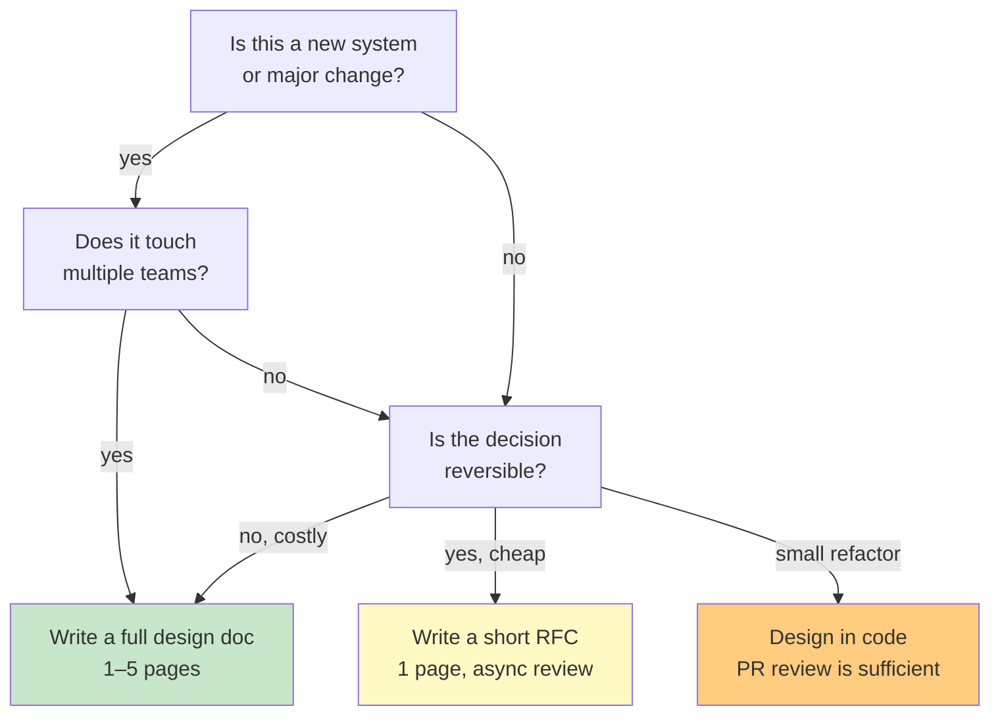

# Design Docs & RFCs: Capturing Decisions, Building Alignment

## First Principles: Why Design Documents Matter

A **design document (design doc)** is a written proposal for a technical system or change. An **RFC (Request for Comments)** is a formal design doc review process used to build consensus before implementation.

**Why they matter:**

```
Without a design doc:
  - Engineer A starts building feature X
  - Engineer B discovers they're also building feature X
  - Manager learns about X only at code review
  - Infrastructure team says X won't scale at month 3
  → Rework: 2–4 weeks of lost effort
  → Misalignment on requirements
  → No written decision record

With a design doc:
  - Engineer A writes 3-page proposal for feature X
  - Gets feedback from B, infrastructure team, PM in 2 days
  - Decision is written and archived
  - Implementation aligns with agreed scope
  → 1 week of saved effort
  → Clear ownership and decision rationale
  → Future engineers understand WHY, not just WHAT
```

**Core principle:**

> Writing forces clarity. Clarity before code saves weeks later.

Design docs serve three purposes:
1. **Alignment:** Stakeholders understand the proposal before work begins.
2. **Decision record:** Why was this chosen over alternatives? (invaluable in 6 months)
3. **Teaching:** New hires read old docs to understand system evolution.

---

## The Problem: Scope Creep and Misalignment

You're asked to redesign the payment service. Without a doc:

```
Monday 9 AM: "Redesign payment service"
Monday 5 PM: Engineer A starts coding state machine
Tuesday 8 AM: PM asks, "Does it support refunds?"
Tuesday 2 PM: Infrastructure team warns, "Won't work at scale"
Wednesday 10 AM: Architect reviews, "This violates our API contract"
Thursday: Rework decision. Back to Monday.
```

**Lost:** 1 week. Unclear scope. No written decision.

**With a design doc:**

```
Monday 10 AM: Engineer A writes 4-page design doc
  - Scope: payment creation, cancellation, refunds
  - Non-goals: subscription billing, tax calculation
  - Scalability: 10K requests/sec, <100ms P99
  - Alternatives considered: state machine vs event log
  
Monday 4 PM: PM, infrastructure, architect review
  → PM: "Add dispute resolution in phase 2, not scope"
  → Infrastructure: "Event log design won't work; try state machine"
  → Architect: "API contract OK; make sure webhooks are idempotent"
  
Tuesday 10 AM: Design doc updated with feedback
Tuesday 11 AM: Implementation begins with full alignment
```

**Won:** 1 week saved. Clear scope. Documented rationale.

---

## Design Doc Structure

**Typical template (1–5 pages):**

```
# [System Name] Design Doc

## Problem Statement
- What's broken? What's the user pain?
- Why now? (metrics, urgency)
- Link to issue/ticket

## Goals & Non-Goals
Goals:
  1. Support refunds within 30 seconds
  2. Audit trail for all transactions
  
Non-goals:
  - Subscription billing (Phase 2)
  - Real-time revenue reporting (separate system)

## Proposed Solution
- High-level architecture (ASCII diagram)
- Key components (data model, APIs, services)
- How does it work? (step-by-step example)

## Alternatives Considered
- Alternative A: [why rejected]
- Alternative B: [why rejected]
- Chosen: [why it's best]

## Scalability & Trade-offs
- Expected load: 10K req/sec
- Latency target: P99 < 100 ms
- Storage: estimate data volume, retention
- Trade-offs: consistency vs availability (explain choice)

## Implementation Plan
- Phase 1 (weeks 1–2): data model + API
- Phase 2 (weeks 3–4): webhook system
- Testing: unit, integration, load tests
- Rollout: gradual, with feature flags

## Risks & Mitigation
- Risk: Database can't handle 10K req/sec
  → Mitigation: Load test early, shard if needed
- Risk: Schema change is backward-incompatible
  → Mitigation: Dual-write, validate both paths before cutover

## Open Questions
- Should refunds be async (eventual consistency)?
- Should we support partial refunds? (awaiting PM)
```

---

## Real Example: Incident Response Through Design Doc

**Scenario:** Your payment system has a bug. Transactions are recorded twice. Your manager asks, "How did this happen?"

```
You: "State machine logic was unclear. No one documented the design."

Manager: "OK, redesign it. And write it down."

You write design doc:
- Problem: unclear state transitions (7 states, 21 transitions)
- Root cause: no single source of truth
- Solution: Event sourcing (immutable event log)
- Trade-off: eventual consistency (max 500ms)
- Phases: events + replay + cutover

Benefits:
1. Writing the doc, you realize: "Webhook retries could cause double-credit"
2. You catch a bug BEFORE code
3. Team understands why Event Sourcing, not Saga
4. In 6 months, new hire reads it and learns system
```

---

## Decision-Making Framework: Choosing Design Approach

When do you write a design doc?



---

## When to Use / When NOT to Use Design Docs

| Scenario | Use Doc? | Example |
|----------|----------|---------|
| New payment system | YES (1–5 pages) | Redesign refund flow |
| Database migration | YES (2–4 pages) | PostgreSQL 12 → 15 |
| Optimize cache hit rate | MAYBE (1 page) | Change cache key format |
| Fix UI button color | NO | Just update in PR |
| Add new feature flag | MAYBE (1 page) | Feature flag for new checkout |
| Deprecate old API | YES (2 pages) | Why, timeline, migration path |
| Refactor code cleanup | NO | Code review is enough |
| Change error budget policy | YES (1–2 pages) | How SLOs affect prioritization |

---

## Story Card: RFC Prevents Post-Launch Crisis

**Setup:** Team is building a new orders API. One engineer starts coding, another reviews.

**Without RFC:**
```
Friday 5 PM: Engineer A submits PR for new /orders endpoint
  Returns: [order_id, amount, status]
  
Monday 9 AM: Code review
  Reviewer: "Looks good. Ship it."
  
Monday 2 PM: Deployed to production
Monday 6 PM: Dashboard breaks
  
Root cause: Dashboard expects (amount_usd, timestamp) but gets (amount, status)
Solution: Pull PR, rebuild, re-deploy
Time lost: 4 hours, customer impact: billing page down
```

**With RFC:**
```
Friday 10 AM: Engineer A writes 2-page RFC for /orders endpoint
  Proposes: [order_id, amount_usd, timestamp, status]
  
Friday 11 AM: Reviewer (who owns dashboard) sees RFC
  Feedback: "amount_usd not amount. And add timestamp for sorting."
  
Friday 2 PM: RFC updated and approved
Friday 3 PM: Implementation starts with correct schema
  
Monday: Deploy without incident
Zero customer impact, correct schema first try.
```

**Key learning:** RFC catches integration issues BEFORE code, when fixing is cheap.

---

## Reasoning Framework: RFC Process

```
Is this a new system or cross-team change?
  → YES: Write design doc (1–5 pages)
       → Review with stakeholders (2–5 days)
       → Iterate based on feedback
       → Lock decision: "RFC approved"
       → Code now matches agreed design
  
  → NO (single team, small change): Write short RFC (1 page)
       → 24-hour review
       → Approve or request changes
       → Implement
  
  → NO (small, reversible change): Design in code
       → PR review is the design review
       → This is fine for refactors, minor features
```

---

## Q&A (Built on Fundamentals)

**Recall 1:** You're asked to redesign the payment system. What should you do first?

*Must-say:*
- Write a design doc or RFC
- Identify stakeholders (PM, infrastructure, security)
- Define scope, non-goals, alternatives
- Get alignment before coding

**Probe 1:** Your team has a 3-person frontend feature. Do you need a design doc?

*Expected:*
- Depends: Is it isolated or does it touch backend/data?
- If isolated and reversible: maybe just PR review is enough
- If it changes API contract: yes, write 1-page RFC
- If it requires new service: yes, 3–5 page doc

**Probe 2:** You write a design doc. The architect disagrees with your choice. What now?

*Expected:*
- This is normal. Don't take it personally.
- Understand their concern: scalability? cost? operational burden?
- Propose compromise: "What if we use [choice A] for phase 1 and [choice B] for phase 2?"
- If still stuck: escalate to decision-maker (who owns the service?)
- Document the decision and rationale, even if you disagree

**Numeric 1:** Your design doc estimates a system will handle 10K requests/second. Your infrastructure team says the database can only do 5K/sec. What do you change?

*Working:*
- Option A: Redesign for 5K requests/sec, launch slower
- Option B: Add caching to reduce DB load (probabilistic: 5K * 0.3 cache hit rate = 1.5K DB requests)
- Option C: Shard the database (10K / 3 shards = 3.3K per shard, under 5K limit)
- Best: Option B+C combined. Revisit design doc with new numbers.

**Numeric 2:** You're building a new service with 3 teams (frontend, backend, data). How long should RFC review take? How many reviewers?

*Working:*
- Typical: 2–5 day async review period
- Reviewers: architect (1), PM (1), each team lead (3) = 5 people
- Decision: RFC approved when architect + at least 2 team leads sign off
- Escalation: If blocked after 5 days, discuss synchronously
- Document decision in the RFC, even if not unanimous

---

## Questions for the Interviewer

- How do you handle disagreement in design reviews?
- What's the worst case of "no design doc"? (story time)
- How do you decide scope in a design doc?
- Have you redesigned something and wished you'd documented the first design?
- What's your bar for "this needs a doc" vs "just code it"?

---

## Checklist: Design Doc Quality

- [ ] **1. Problem is clear:** Reader understands what's broken and why NOW
  - ❌ Wrong: "We need a better payment system"
  - ✓ Right: "Refunds take 3 days; customer support gets 50 complaints/week; we lose $X revenue/month"

- [ ] **2. Non-goals are explicit:** What's NOT in scope?
  - ❌ Wrong: Design doc doesn't mention what's out of scope
  - ✓ Right: "Phase 1 is refunds only; subscription billing is phase 2, deferred"

- [ ] **3. Alternatives are real:** You considered real options and explain tradeoffs
  - ❌ Wrong: "Alternative A: bad, Alternative B: good" (no reasoning)
  - ✓ Right: "Alternative A (Saga pattern): simpler but eventual consistency. Alternative B (Event Sourcing): complex but stronger guarantees. We pick B because..."

- [ ] **4. Scalability is numbered:** Not vague ("big scale"). Use numbers.
  - ❌ Wrong: "System must be scalable"
  - ✓ Right: "10K req/sec P99 latency <100ms; 1 year data retention = 32 TB"

- [ ] **5. Open questions are honest:** Flag unknowns
  - ❌ Wrong: Design doc says everything is locked in day 1
  - ✓ Right: "Open question: should refunds be async? Awaiting PM input. Decision blocks phase 2."
