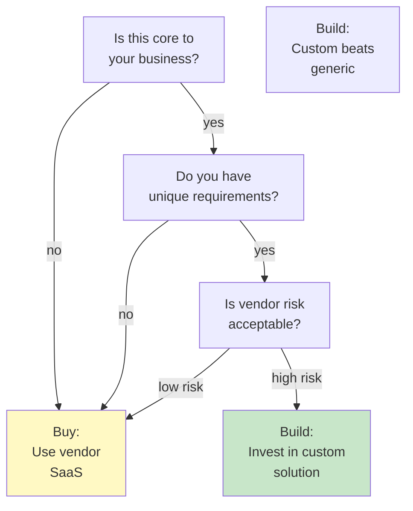
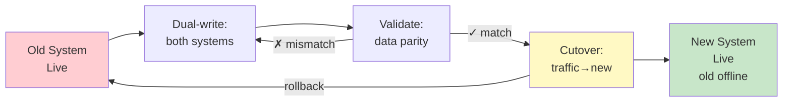

# Build vs Buy & Migrations: Trade-off Analysis, Data Consistency, Cutover Planning

## First Principles: The Build vs Buy Decision

**Build:** Write software yourself. Full control, can customize, but you own maintenance cost.

**Buy:** Use a third-party product (SaaS, vendor, open-source). Lower maintenance, but less control, risk of vendor lock-in.

**Migrate:** Switch from one system to another (Build→Buy, Buy→Build, or Build→Build). This is the hard part—moving live data without downtime.

```
Build:
  Pros: Custom, no vendor risk, cheaper long-term if complex
  Cons: Engineering cost, maintenance burden, slower to launch

Buy (SaaS):
  Pros: Faster launch, vendor handles operations, less engineering
  Cons: Less customizable, vendor risk, monthly cost

Migrate:
  Pros: Fix mistakes from bad initial choice
  Cons: Risk of data loss, downtime, customer impact
  Cost: 2–3x the implementation cost of original system
```

---

## The Problem: Legacy System is Choking

Your company built an in-house CMS 5 years ago. It works, but:

```
Issues:
  - Takes 8 weeks to add a field
  - 40% of engineering time spent on operational tasks (backups, migrations)
  - New hires can't understand the codebase
  - Performance is acceptable but expensive (3 database servers)
  - Can't scale to new product line (SaaS multi-tenant model)
  
Customer impact:
  - Product team waits for engineering to add features
  - Outages every quarter (2–4 hours)
  - Competitors iterate 2x faster
  
Decision: Build anew or buy ContentfulStack?
```

---

## Build vs Buy Decision Matrix

Before you migrate, decide: keep building or switch?



**Example calculations:**

```
Build In-House CMS:
  Initial dev: 3 engineers * 4 months = 12 eng-months = $300K
  Annual maintenance: 2 engineers = $200K/year
  10-year cost: $300K + (10 * $200K) = $2.3M
  
Buy Contentful SaaS:
  Setup: 1 engineer * 2 weeks = $20K
  Annual cost: $10K/month = $120K/year
  10-year cost: $20K + (10 * $120K) = $1.2M
  
Delta: $1.1M saved by buying
  But: You lose customization, feature velocity depends on vendor
```

---

## Migration Planning: Data Consistency

When you migrate from old system to new system, you must:

1. **Dual-write:** Write to both systems simultaneously (can't lose data)
2. **Validate:** Ensure both systems have identical data
3. **Cutover:** Switch traffic from old to new
4. **Rollback plan:** If new system fails, revert to old



**Critical:** You cannot afford data loss or inconsistency.

---

## Real Example: CMS Migration (2 Month Cutover)

**Timeline:**

```
Week 1–2: Dual-write phase
  - New CMS running in shadow mode (writes only, no reads)
  - Old CMS is source of truth
  - Validation: diff records from both systems every hour
  - Risk: dual-write fails mid-transaction
  
Week 3–4: Backfill + reconciliation
  - Write historical data to new CMS
  - Validate all 500K records match
  - Fix discrepancies (schema mapping, type coercion)
  - Risk: data mismatch not caught until go-live
  
Week 5–6: Read-from-new phase
  - 10% of users read from new CMS
  - Monitor error rates, latency
  - If good: increase to 50%, then 100%
  - Risk: edge cases only hit at high volume (canary fails)
  
Week 7: Cutover
  - All traffic on new CMS
  - Old system still running (fallback)
  - Risk: bug discovered post-cutover, need to rollback
  
Week 8: Sunset old system
  - Wait 1 week (no incidents)
  - Turn off old CMS
  - Decommission servers
  - Cost savings: $200K/year
```

**Failure scenario:**

```
Week 5: Deploy canary
  - 10% traffic to new CMS
  - P99 latency: 800 ms (expected <400 ms)
  - Root cause: missing index on popular query
  
Decision point:
  Option A: Fix index, wait 1 week for stability, retry canary
  Option B: Continue with 800 ms latency (customers notice)
  Option C: Rollback to old system, restart plan
  
Best choice: Option A
  Trade-off: 1 extra week, but safe cutover
  Alternative: Accept latency risk (not acceptable for live system)
```

---

## Dual-Write and Reconciliation

The most critical step is validation:

```
Dual-write example:

Request arrives: POST /content/create?title=...
  ↓
  ├→ Write to old CMS (synchronous)
  └→ Write to new CMS (async, best-effort)
  
Problem: Async write fails, old has data but new doesn't
Solution: Async queue + retry logic
  
  Request arrives: POST /content/create
  ├→ Write to old CMS (synchronous)
  ├→ Queue async job: "write-to-new-cms"
  └→ Return 200 OK
  
  Background job:
    ├→ Write to new CMS (retry 3x)
    ├→ Log reconciliation record
    └→ Alert if 3 retries fail
  
Validation (hourly):
  ├→ SELECT COUNT from old CMS → 500,000 records
  ├→ SELECT COUNT from new CMS → 499,900 records
  └→ Diff: 100 missing → investigate + backfill
```

---

## Cutover Patterns: Four Strategies

**Pattern 1: Big Bang (risky)**
```
Old system is live Monday 5 PM.
Switch all traffic Tuesday 10 AM.
Risk: Any bug affects all users immediately.
Only use: small systems with simple data model.
```

**Pattern 2: Canary (recommended)**
```
Monday: 90% old, 10% new
Tuesday: 70% old, 30% new (if no errors)
Wednesday: 50/50
Thursday: 100% new
Risk: Gradual, issues caught early.
Best for: most systems.
```

**Pattern 3: Feature Flag (safest)**
```
New system deployed but unused.
Feature flag "use_new_cms": false
Week 1: Gradually enable for 1%, 10%, 50%, 100% of users
Risk: Lowest, because feature flag lets you flip instantly.
Best for: user-facing changes.
```

**Pattern 4: Parallel Running (most expensive)**
```
Old system and new system both live.
Compare results for days/weeks.
Cut over only when confident.
Risk: Cost is high, but certainty is guaranteed.
Best for: critical systems (payment, medical records).
```

---

## When to Use / When NOT to Use Approaches

| Scenario | Build | Buy | Notes |
|----------|-------|-----|-------|
| Payment processing | NO | YES | Too risky to build; vendor has scale |
| CMS for 10M users | NO | YES | Contentful, Sanity proven at scale |
| Internal tooling | YES | NO | Quick to build, rarely used, not worth vendor cost |
| Recommendation engine | MAYBE | YES | Vendor (e.g., Algolia) is good; build if special needs |
| Authentication | NO | YES | Auth0, Okta are battle-tested; don't build |
| Real-time analytics | YES | MAYBE | Build for control; buy if latency isn't critical |
| Email service | NO | YES | SendGrid, Mailgun proven; complexity is hidden |

---

## Story Card: Failed Migration (Data Corruption)

**Setup:** Company is migrating from in-house database to managed PostgreSQL.

**Mistake:** Engineer skips dual-write validation step to save time.

```
Wednesday: Deploy new system, canary 10%
Thursday: All users switched to new system
Thursday 2 PM: Customer reports missing orders
Thursday 3 PM: Investigation: 5% of orders from past 6 months are missing
Thursday 4 PM: Root cause found
  - Migration script had a bug (corrupt timestamp parsing)
  - Affected orders from before June 2024
  - 50K orders affected, $2M in revenue records at risk

Response:
  1. Rollback to old system (2 hours, customers unhappy)
  2. Re-run migration with fix (careful validation this time)
  3. Canary again, slowly, 1% → 10% → 50% → 100%
  4. Cutover: 2 weeks later (not Thursday)

Cost of mistake:
  - 2 weeks of delayed cutover
  - 2 days of engineering debugging
  - Customer trust: "Did we lose my data?" (no, but scary)
  - Could have been prevented by: dual-write + hourly reconciliation

Lesson: Skip validation to save 1 week → cost 2 weeks later
```

---

## Reasoning Framework: Build vs Buy vs Migrate

```
Step 1: Identify the problem
  - Is the current system actually the bottleneck?
  - Is it blocking growth or just annoying?
  - Measure: how much time/cost does it cause?

Step 2: Evaluate options
  Option A: Keep building in-house
    - Cost: 3 engineers * $200K = $600K/year
    - Control: 100%, customizable, no vendor risk
  
  Option B: Buy SaaS
    - Cost: $120K/year, setup $20K
    - Control: 20%, limited customization, vendor risk
  
  Option C: Hybrid (buy core, build extensions)
    - Cost: $120K + 1 engineer = $220K/year
    - Control: 60%, balanced

Step 3: Estimate migration cost
  - Dual-write phase: 1 month
  - Validation: 1 month
  - Canary: 2 weeks
  - Total: 2–3 months, 1–2 engineers
  - Risk: data loss or extended downtime

Step 4: Decide based on:
  - Is it core to business? (pay to build)
  - Is vendor risk acceptable? (buy if yes)
  - What's the 10-year cost? (use that number)
  - Can you afford 2–3 month migration? (affects decision)
```

---

## Q&A (Built on Fundamentals)

**Recall 1:** You're evaluating whether to build or buy a CMS. What questions should you ask?

*Must-say:*
- Is CMS core to our product differentiation?
- What are unique requirements we can't buy?
- What's the 5–10 year cost of building vs buying?
- What's our vendor risk tolerance?

**Probe 1:** You decide to buy Contentful. Now you need to migrate your old CMS data. What's your first step?

*Expected:*
- Write a migration plan (design doc)
- Define data mapping (old schema → new schema)
- Plan dual-write phase (both systems live)
- Plan validation (reconciliation hourly, resolve mismatches)

**Probe 2:** Your migration plan says "cutover next Tuesday." Your validation finds 5% data mismatch. What do you do?

*Expected:*
- Do NOT cutover Tuesday. Too risky.
- Investigate mismatches (schema mapping? data corruption?)
- Fix root cause
- Revalidate until 100% match or acceptable error rate
- Then cutover (maybe 1 week later)
- This is the right call even if it delays launch.

**Numeric 1:** Build a CMS costs 3 engineers * $200K/year. Buy Contentful is $120K/year + $20K setup. When does "buy" break even with "build"?

*Working:*
- Annual delta: $200K (build) - $120K (buy) = $80K/year
- Break-even: $20K (setup) / $80K (annual) = 3 months
- After 3 months, buy is cheaper every year
- If you keep it 5 years: buy saves $80K * 5 = $400K total

**Numeric 2:** Your migration plan has a dual-write phase (1 month) and validation phase (1 month). If dual-write fails 2% of the time and you discover mismatches hourly, how many mismatches do you expect to find before cutover?

*Working:*
- 2 months = 60 days = 1,440 hours
- Hourly validation: 1,440 checks
- 2% failure rate: 1,440 * 0.02 = 28.8 mismatches expected
- So plan to find ~30 mismatches, fix them, revalidate
- This is normal. Accept it.

---

## Questions for the Interviewer

- Have you done a major migration? What went wrong?
- How do you decide build vs buy in your org?
- What's the biggest risk in a live system migration?
- How do you validate data consistency across two systems?
- Have you had to rollback a migration? What did you learn?

---

## Checklist: Migration Readiness

- [ ] **1. Plan is documented:** Design doc exists with timeline, phases, rollback procedure
  - ❌ Wrong: "We'll migrate next month" (no plan)
  - ✓ Right: Migration plan (doc) with dual-write dates, validation schedule, cutover date, rollback steps

- [ ] **2. Data mapping is tested:** You've validated that old schema → new schema works for 100% of records
  - ❌ Wrong: Assume mapping will work; find bugs at cutover
  - ✓ Right: Run migration script on copy of prod data, validate row counts and sample records

- [ ] **3. Dual-write is async with retries:** Failed writes don't break old system; they queue for retry
  - ❌ Wrong: Dual-write is synchronous; if new system is slow, old system becomes slow
  - ✓ Right: Write to old (sync), queue async job to write to new (retry 3x, alert on failure)

- [ ] **4. Validation is automated and hourly:** You find mismatches before cutover, not after
  - ❌ Wrong: Manual spot-checks
  - ✓ Right: Hourly reconciliation job that counts/diffs records, alerts on mismatch > 0.1%

- [ ] **5. Rollback is tested:** You've practiced reverting to old system before cutover
  - ❌ Wrong: Rollback plan exists but untested
  - ✓ Right: You've simulated rollback (turn off feature flag, switch traffic back to old system, verify no data loss)
