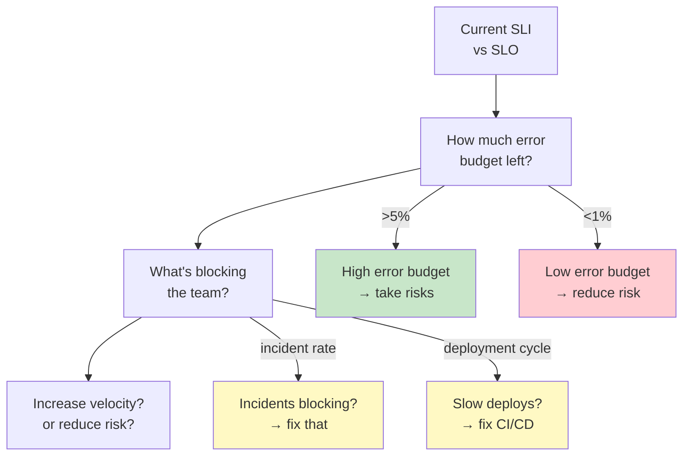

# Error Budgets & Prioritization: SLOs, Customer Impact, Resource Allocation

## First Principles: SLO, SLI, and Error Budget

**SLO (Service Level Objective):** A target. "We promise 99.9% uptime."

**SLI (Service Level Indicator):** A measurement. "We achieved 99.87% uptime this month."

**Error budget:** The difference. If you promised 99.9% and achieved 99.87%, you spent 0.03% of your budget and have 0% left for the month.

```
SLO: 99.9% uptime (0.1% = 8.76 hours/month downtime allowed)
SLI: 99.87% actual (0.13% = 9.36 hours/month downtime)
Error budget: spent 0.03% / 0.1% = 30% of budget

Interpretation:
  - You've used 30% of error budget
  - You have 70% left (6 hours) for rest of month
  - If you deploy a risky change and it fails for 1 hour, you've spent another 3% of budget
  - Question: Can you afford that risk now? Or should you wait for next month?
```

**Why this matters:**

```
Without error budget thinking:
  - Team deploys risky feature Friday afternoon
  - Feature causes 20 min outage Saturday 2 AM
  - Customers are angry
  - CEO asks: "Why did you deploy Friday?"
  - Answer: "We didn't know it would break"

With error budget thinking:
  - Friday morning: Check error budget (70% remaining)
  - Feature risk: Medium (could cause 5% outage)
  - Decision: Wait until Monday morning (fresh week = fresh budget)
  - Monday 10 AM: Deploy, monitor closely
  - If outage occurs, happens during business hours when team can respond
```

---

## The Problem: Unlimited Bugs, Limited Time

You're a staff engineer at a $1B SaaS company. Your team has:

- 50 feature requests in backlog
- 30 bugs reported (10 blocking customers, 20 minor)
- 15 technical debt items (slow deploys, flaky tests, old dependencies)
- 3 engineers, 6-week sprint

**Impossible to do all of it. How do you prioritize?**

```
Without error budget thinking:
  - Build features (customer-facing revenue)
  - Fix critical bugs (immediate pain)
  - Ignore tech debt (can fix later)
  → Deploys slow down, tests become flaky, incidents increase
  → Next quarter: 50% of time fighting fires instead of building

With error budget thinking:
  - Calculate: If we do X, can we stay within SLO?
  - If yes: do it
  - If no: fix operational issues first
  → Predictable velocity, fewer incidents
```

---

## Deriving Prioritization From Error Budget

**Framework:**



---

## Real Example: Prioritization Using Error Budget

**Scenario:** It's Monday. You have 6 weeks.

**Current state:**
```
SLO: 99.9% (8.76 hours/month downtime)
SLI so far this month: 99.95% (4.38 hours downtime used)
Error budget remaining: ~4 hours (45% of budget)

Incidents last month:
  - 2 outages (main database, 2 hours total)
  - 5 degradations (slow API, 1 hour total)
  - Root causes: buggy feature flag, missing index, memory leak

Backlog:
  1. Feature A: $500K/quarter if launched (3 weeks, medium risk)
  2. Bug: Memory leak (3 days, low risk, prevents incidents)
  3. Feature B: $100K/quarter if launched (2 weeks, high risk)
  4. Flaky tests slowing deploys (1 week, low risk)
  5. Database index missing (2 days, low risk)
```

**Prioritization decision (with error budget):**

```
Week 1–2: Reduce risk (because budget is tight)
  - Fix memory leak (3 days)
  - Add missing database index (2 days)
  - Fix flaky tests (5 days)
  → Goal: No incidents for 2 weeks, restore confidence

Week 3–4: Feature A (medium risk, high value)
  - 3 weeks of development
  - Deploy with feature flag (low risk because flag lets us revert instantly)
  - After 1 week, we have 3 hours error budget left (enough to handle incidents)

Week 5–6: Start Feature B (high value, but risky)
  - 2 weeks of development
  - Do NOT deploy yet (finish after error budget resets next month)
  - Deploy first week of next month when budget is fresh

Rationale:
  - We spent 50% of error budget fixing bugs
  - This prevents future incidents (expected: save 2–3 hours/month)
  - Feature A is deployed with safety (feature flag)
  - Feature B waits for next month (too risky to launch when budget is low)
```

---

## SLI Definition Matters

How you define SLI determines what you optimize for:

```
Option 1: "99.9% of requests succeed"
  Measures: Did the request return a 2xx status code?
  Problem: Slow request (5 second latency) is still a "success"
  Consequence: Team doesn't care about performance (counts as success)

Option 2: "99.9% of requests return within 1 second"
  Measures: Latency percentile (P99.9 < 1 second)
  Problem: 1 second might be too strict for batch jobs
  Consequence: Team optimizes latency, but overbuilds for some workloads

Option 3: "99.9% of user-facing requests return within 1 second"
  Measures: Latency for requests from logged-in users (exclude background jobs)
  Problem: Might ignore batch job reliability
  Consequence: Balanced: users get fast responses, batch jobs can be slower

BEST PRACTICE:
  - Define SLI that matches customer experience
  - Segment by customer type (premium vs free, user vs batch)
  - Review quarterly (is this still the right goal?)
```

---

## Story Card: Feature Launch During Low Error Budget

**Scenario:** It's end of month. Error budget is nearly empty.

**Team wants to ship Feature X (risky database migration) Friday afternoon before holiday.**

```
Friday 9 AM: Staff engineer reviews
  Error budget: <0.5% remaining (15 minutes downtime available)
  Feature risk: Medium (could cause 1–2% outage if buggy)
  Holiday: Monday–Wednesday (no team on call)
  
Decision: DO NOT DEPLOY FRIDAY
  
Reasons:
  1. If bug happens Friday 5 PM, team is gone for 3 days
  2. Error budget is empty (can't afford any incidents)
  3. Even if feature is good, we don't have margin for error
  
Alternative: Deploy Monday at 10 AM
  1. Team is on call, can respond instantly to issues
  2. Error budget resets (new month = new budget)
  3. Feature still ships this month, but safely
  
Team reaction:
  "But we wanted to ship before holiday!"
  Staff engineer: "You will. Monday instead of Friday. Better to ship safely."
  
Result:
  - Feature launched Monday with zero incidents
  - If we'd launched Friday, 1-hour outage Saturday → customer impact, post-mortem
```

**Key insight:** Error budget helps you say "no" to risky timing, even when pressure is high.

---

## Allocating Time: Feature vs Operational Work

Use error budget to decide feature velocity:

```
Low error budget month (< 10% remaining):
  Allocation:
    - 60% reducing technical debt / fixing bugs
    - 20% fighting incidents (reactive)
    - 20% new features
  
  Why: We're unstable. Stabilize first.
  
Mid error budget month (10–50% remaining):
  Allocation:
    - 40% reducing technical debt / operational work
    - 10% incident response
    - 50% new features
  
  Why: We can take calculated risks while improving stability.
  
High error budget month (> 50% remaining):
  Allocation:
    - 20% operational work
    - 5% incident response
    - 75% new features
  
  Why: System is stable. Go fast.
```

---

## When to Use / When NOT to Use Error Budget Framework

| Scenario | Use Error Budget? | Example |
|----------|------------------|---------|
| SaaS product (customer-facing) | YES | Stripe, Notion, GitHub |
| Internal tool | MAYBE | If used by critical path, yes; if not, just fix bugs when found |
| Startup MVP | NO | Stability is secondary; ship fast |
| Infrastructure (platform) | YES | Kubernetes, database cluster |
| Open-source library | MAYBE | If widely used, yes; if niche, not critical |
| One-time batch job | NO | Success or failure is binary, not about uptime |
| Real-time trading system | YES | Error budget is hours/year, not hours/month |

---

## Reasoning Framework: Incident Response Using Error Budget

```
Incident occurs: "API is 10x slower than normal"

Step 1: Measure impact
  - What % of requests are affected? (100% of user API)
  - Latency: was 100ms, now 1 second (10x)
  - Duration: how long will it last? (15 min estimated)
  
Step 2: Calculate error budget cost
  - 100% of traffic × 15 minutes = 100% * 15/(30*24*60) ≈ 0.035% (month)
  - How much budget do we have? (say, 5% remaining)
  - Decision: We can afford the 15 min downtime. Continue debugging normally.

Step 3: But if budget was < 1%?
  - Immediate decision: Rollback or kill feature (save error budget)
  - Root cause analysis happens after SLA is safe
  - This is OK. Different risk calculus when budget is low.
```

---

## Q&A (Built on Fundamentals)

**Recall 1:** Your SLO is 99.9% uptime. Your SLI this month is 99.85%. How much error budget do you have left?

*Must-say:*
- 99.9% SLO = 0.1% error budget = 8.76 hours/month
- 99.85% SLI = 0.15% used = 12.96 hours spent
- Wait, that's over budget. How did that happen?

*Correct interpretation:*
- If you achieved 99.85%, you've USED 50% of budget and have 50% left
- Or you're over SLA (which is a problem—need incident review)

**Probe 1:** Your team is pushing to launch Feature A on Friday. Feature is risky (could cause outage). Your error budget is 1% remaining. What do you say?

*Expected:*
- "No. Too risky. Wait until Monday."
- Reasons: (1) budget is tight, (2) team won't be on call Friday evening, (3) holiday weekend = slow response
- You're being a staff engineer: protecting both feature velocity AND stability

**Probe 2:** You have two projects: Feature B (safe, medium value) and Refactor C (risky, high operational benefit). Which do you do first?

*Expected:*
- Depends on error budget
- Low budget: Refactor C first (reduce future incidents, make velocity stable)
- High budget: Feature B first (safe, ships revenue)
- Staff engineer's job: explain the trade-off

**Numeric 1:** Your SLO is 99% uptime. You have 30 days in the month. How many hours can you be down?

*Working:*
- 99% = 1% error budget
- 1 month = 30 * 24 = 720 hours
- 1% * 720 = 7.2 hours
- You can afford 7 hours 12 minutes of downtime this month

**Numeric 2:** You've used 6 hours of your 7.2-hour budget. You want to deploy a feature that's 95% confident (5% chance of 1-hour outage). Can you deploy?

*Working:*
- Error budget remaining: 7.2 - 6 = 1.2 hours
- Feature risk: 5% * 1 hour = 0.05 hours expected outage
- But worst case: 5% chance of 1 hour outage = risk is too high
- Decision: NO, don't deploy. Wait for next month.
- Alternative: Deploy with feature flag (can revert in 5 minutes if bad)

---

## Questions for the Interviewer

- How does your team use error budgets?
- Have you had to say "no" to a feature launch based on SLO risk?
- How do you define SLI for your system?
- How do you balance feature velocity with reliability?
- What happens when you run out of error budget mid-month?

---

## Checklist: Error Budget Governance

- [ ] **1. SLO is written and agreed:** Not vague ("stable"), specific ("99.9% uptime")
  - ❌ Wrong: SLO is assumed, not documented
  - ✓ Right: "SLO: 99.9% uptime, P99 latency < 1 second, measured monthly"

- [ ] **2. SLI measures what customers care about:** Not just "requests that don't error"
  - ❌ Wrong: "99.9% of requests return a status code" (includes 5xx errors as success)
  - ✓ Right: "99.9% of requests return 2xx with latency < 1 second"

- [ ] **3. Error budget is tracked in real-time:** Team knows status at any point in month
  - ❌ Wrong: "We'll check SLO at end of month"
  - ✓ Right: Dashboard showing SLI, error budget %, and forecast for month

- [ ] **4. Deployment risk is assessed against budget:** Risky changes don't launch when budget is tight
  - ❌ Wrong: Deploy whenever ready, regardless of error budget
  - ✓ Right: "Feature is 90% confident, budget is 2%, so wait for next month"

- [ ] **5. Incidents are blameless, but tracked:** Post-mortem records how much error budget was spent and what failed
  - ❌ Wrong: "Who broke production?" (blame-focused, suppresses honesty)
  - ✓ Right: Post-mortem: "Root cause: missing index. Cost: 2 hours downtime = 20% of budget. Fix: add index, add monitoring."
